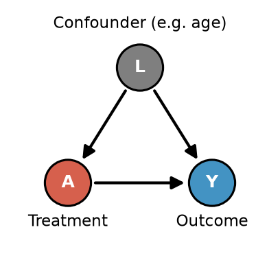
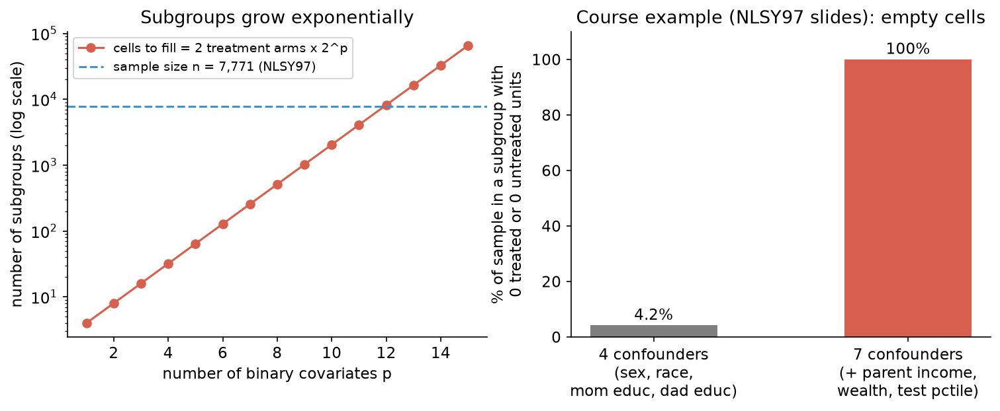
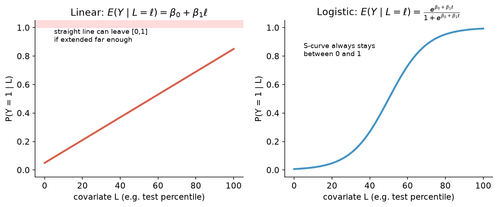

# 1. Glossary and Foundations

This file defines every term and symbol used in Quiz 3, then explains the big picture: **why** Module 5 exists.

[← Back to index](README.md) · [Next: g-formula →](02_standardization_g_formula.md)

---

## 1.1 Notation cheat table

| Symbol | Read it as | Meaning |
|---|---|---|
| $A$ | "A" | **Treatment** (exposure). Usually binary: $A=1$ treated, $A=0$ untreated. E.g. job training. |
| $Y$ | "Y" | **Outcome**. E.g. income. |
| $L$ or $\vec L$ | "L", "L-vector" | **Confounders / covariates**: variables we adjust for (age, education…). The arrow means "possibly several variables". |
| $\ell$, $\ell_i$ | "little ell" | A specific **value** of $L$. $\ell_i$ is person $i$'s value. |
| $i$ | | Index for a person (unit). |
| $n$ or $N$ | | Total sample size. $n_t$ = number treated, $n_c$ = number of controls. |
| $Y^a$, $Y^{a=1}$, $Y^{a=0}$ | "Y superscript a" | **Potential outcome**: the outcome that *would* occur if treatment were set to $a$. |
| $E(\cdot)$ | "expected value of" | The **population average** (mean with infinite data). |
| $E(Y\mid A=1, L=\ell)$ | "expected Y given A equals 1 and L equals ell" | **Conditional expectation**: the average outcome among people with $A=1$ and $L=\ell$. |
| $\hat{\ }$ (hat) | "hat" | An **estimate** computed from a sample. $\hat E$ is an estimated average, $\hat\pi$ an estimated propensity. |
| $P(\cdot)$ or $\Pr(\cdot)$ | "probability of" | Probability. |
| $\pi_i$ | "pi i" | **Propensity score** of person $i$: $P(A_i=1\mid L_i)$. (Not 3.14!) |
| $\sum_{i:A_i=1}$ | "sum over i such that A_i = 1" | Add up only over the **treated** people. |
| $\perp\!\!\!\perp$ | "independent of" | Statistical independence. |
| $\alpha, \beta, \gamma$ | alpha, beta, gamma | **Regression coefficients** (parameters). |
| $\Sigma$ | "Sigma" (capital) | **Variance–covariance matrix** (in the Mahalanobis distance). Not the summation sign $\sum$. |
| $M_i$ | | The set of **matched controls** for treated unit $i$. $\lvert M_i\rvert$ = how many matches. |

---

## 1.2 Core causal terms

### Potential outcomes and the Fundamental Problem
Each person has **two** potential outcomes: $Y_i^{1}$ (with treatment) and $Y_i^{0}$ (without). The **individual causal effect** is $Y_i^1 - Y_i^0$.

> **Fundamental Problem of Causal Inference:** we only ever observe **one** of the two for each person. The other is a *counterfactual*.

| Person | $A_i$ | $Y_i^1$ | $Y_i^0$ | Observed $Y_i$ |
|---|---|---|---|---|
| 1 | 1 | **210** | ? | 210 |
| 3 | 0 | ? | **60** | 60 |

Every method in this module is a different strategy for **filling in the "?"** using the other people.

### Causal estimands (the "targets")

| Name | Formula | In words |
|---|---|---|
| **ATE**: Average Treatment Effect | $E(Y^{1}) - E(Y^{0})$ | Average effect if we treated **everyone** vs **no one**. |
| **ATT**: Average Treatment Effect on the Treated | $E(Y^{1}\mid A=1) - E(Y^{0}\mid A=1)$ | Average effect **among people who actually got treatment**. |
| **CATE**: Conditional ATE | $E(Y^1\mid L=\ell)-E(Y^0\mid L=\ell)$ | Average effect within one subgroup (e.g. only old people). |
| **FSATT**: Feasible Sample ATT | ATT among treated units with an acceptable match | What you get when a caliper drops some treated units (matching). |

**ATE vs ATT, visually:** the ATE averages over all the dots, the ATT only over the red (treated) dots. They differ when the effect varies across people (**treatment effect heterogeneity**) *and* treated people differ from untreated people in $L$.

### Assumptions

| Assumption | Formal | Plain English | If violated… |
|---|---|---|---|
| **(Marginal) exchangeability** | $Y^a\perp\!\!\!\perp A$ | Treated and untreated groups are comparable overall (true in a randomized experiment). | Simple difference in means is biased. |
| **Conditional exchangeability** | $Y^a\perp\!\!\!\perp A\mid L$ | Within each level of $L$, treatment is as good as randomly assigned. "No unmeasured confounding." | All methods in this module are biased. |
| **Consistency** | $A_i=a \Rightarrow Y_i=Y_i^a$ | Your observed outcome equals the potential outcome for the treatment you got. Treatment is well-defined. | Potential outcomes are not linked to the data. |
| **Positivity** | $0<P(A=1\mid L=\ell)<1$ for all $\ell$ | Every type of person could get either treatment. | Some groups have no comparison: IPW weights explode, matches don't exist. |

### Confounder, DAG, adjustment set

- **DAG (Directed Acyclic Graph):** nodes are variables; arrows are direct causal effects; no cycles.
- **Confounder:** a common cause of treatment and outcome ($L\to A$ and $L\to Y$). It creates a **backdoor path** $A\leftarrow L\to Y$ that mixes up correlation and causation.
- **Sufficient adjustment set:** a set of variables that, once you condition on them, blocks every backdoor path. Then conditional exchangeability holds.

---

## 1.3 Identification vs Estimation (the key idea of Module 5)

| | **Identification** (weeks 1–7) | **Estimation** (Module 5, quiz 3) |
|---|---|---|
| Question | *With infinite data*, can we recover the causal effect? | *With our finite sample*, how do we get close to it? |
| Objects | $E(Y\mid A=1,L=1)$, a fixed, unknown population number | $\frac{1}{n}\sum_{i:A_i=1,L_i=1}Y_i$, which changes with each new sample |
| Tools | Assumptions: exchangeability, consistency, positivity, DAGs | Statistical models: linear/logistic regression, ML, matching |

**Identification result (the bridge from causal to statistical):**

$$
\begin{aligned}
E(Y^a) &= E\big[E(Y^a\mid L)\big] &&\text{law of iterated expectation (average the subgroup averages)}\\
&= E\big[E(Y^a\mid L, A=a)\big] &&\text{conditional exchangeability}\\
&= E\big[E(Y\mid L, A=a)\big] &&\text{consistency}
\end{aligned}
$$

The last line contains **no potential outcomes**, only things we can estimate from data. Module 5 is about estimating the inner part, $E(Y\mid L, A=a)$, when there are many confounders.

---

## 1.4 Why we need statistical models: the curse of dimensionality

Before Module 5 we estimated $E(Y\mid A=a, L=\ell)$ **nonparametrically**: take the average outcome inside each subgroup (cell) of $L$. That breaks down with many confounders.

**Curse of dimensionality:** as you add covariates, the number of subgroups multiplies (e.g. $p$ binary covariates give $2^p$ subgroups), so each cell gets fewer people. Soon most cells have **zero treated or zero untreated** people, and you can't compute a difference.

From the course example (NLSY97, $n=7{,}771$, effect of college on having a college-educated spouse):
- Adjusting for sex, race, mom's and dad's education gives 4.2% of the sample in a cell with 0 treated or 0 untreated.
- Adding parental income, wealth, and test percentile gives **100%** of the sample in such a cell.

**Empty cells are *almost* a positivity violation, but not exactly.** In the *population* it is possible to see treated and untreated people at every level; we just don't have enough data in our *finite sample*.

**Solution: make statistical assumptions** (a model) that let nearby cells "borrow strength":
- Nonparametric: people at test percentile 60 tell us **nothing** about people at 61.
- Parametric (reasonable assumption): the average at 60 should be **close to** the average at 61, and $P(Y=1)$ should increase smoothly with test percentile.

> "Assume enough to be useful, but not so much that you're wrong." (slides)

---

## 1.5 Statistics vocabulary

| Term | Definition |
|---|---|
| **Estimand** | The quantity you want (e.g. the ATE). |
| **Estimator** | The recipe/formula that turns data into a guess (e.g. the IPW formula). |
| **Estimate** | The number you get from applying the estimator to your data. |
| **Parametric model** | A model with a fixed, small number of parameters, e.g. linear regression $\alpha+\beta A+\gamma L$. Strong assumptions about shape. |
| **Nonparametric model** | Very few shape assumptions (cell means, random forests, very flexible ML). Needs lots of data. |
| **Linear regression (OLS)** | $E(Y\mid L,A)=\alpha+\gamma L+\beta A$. Fitted by **Ordinary Least Squares** (minimizes squared prediction errors). Coefficient $\beta$ = change in predicted $Y$ when $A$ goes 0→1 holding $L$ fixed. |
| **Logistic regression** | For binary $Y$ (or for modeling $A$): $P(Y=1\mid L)=\dfrac{e^{\beta_0+\beta_1 L}}{1+e^{\beta_0+\beta_1 L}}$. S-shaped; predictions always in $[0,1]$. Written $\text{logit}^{-1}(\beta_0+\beta_1L)$. |
| **Interaction term** | A product term like $A\times L$ that lets the treatment effect differ by $L$. |
| **Outcome model** | A model for $E(Y\mid A, L)$. Used by the g-formula. |
| **Propensity (treatment) model** | A model for $P(A=1\mid L)$. Used by IPW and propensity score matching. |
| **Propensity score** $\pi(\ell)$ | $P(A=1\mid L=\ell)$, the probability of being treated given covariates. |
| **Misspecified model** | A model whose form is wrong (e.g. fitting a line to a curve, or leaving out a variable). Gives biased predictions even with infinite data. |
| **Bias** | Systematic error: the average of your estimates (over many samples) minus the truth. "Model not complex enough to capture the true relationship." |
| **Variance** | How much your estimate jumps around from sample to sample. "Model so complex that estimates change a lot between samples." |
| **Overfitting** | A complex model fitting noise in a small sample. Shows up as high variance. |
| **Balance** | The treated and (matched or weighted) control groups have similar distributions of $L$. |
| **Overlap / common support** | Values of $L$ (or $\hat\pi$) where both treated and untreated units exist. Lack of overlap points to a positivity problem. |

**Worked prediction example (from slides):** with $\hat E(Y\mid \text{Test},A)=0.2+0.003\times\text{Test}+0.2\times A$:
- Test = 80, $A=1$: $0.2+0.003(80)+0.2(1)=0.2+0.24+0.2=\mathbf{0.64}$
- Test = 62, $A=0$: $0.2+0.003(62)+0=0.2+0.186=\mathbf{0.386}$

---

## 1.6 The big map of Module 5

| Strategy | What you model | Main estimand on the quiz | File |
|---|---|---|---|
| **Standardization / g-formula** | Outcome $E(Y\mid A,L)$ | ATE (and ATT) | 2 |
| **IPW** | Treatment $P(A=1\mid L)$ | ATE | 3 |
| **AIPW** | Both | ATE (doubly robust) | 4 |
| **Matching** | A distance between units (or $\hat\pi$) | ATT | 6 |

All four rely on the **same identification assumptions** (conditional exchangeability given $L$, consistency, positivity). **They are estimation strategies; none of them fixes an unmeasured confounder.**

[Next: g-formula →](02_standardization_g_formula.md)
