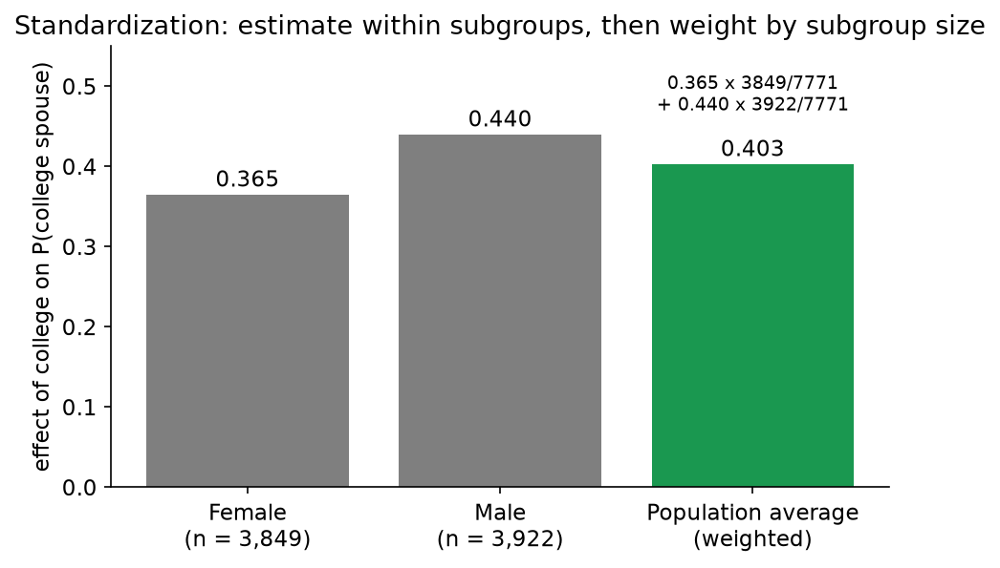

# 2. Standardization and the (Parametric) g-formula — Outcome Modeling

[← Glossary](01_glossary_and_foundations.md) · [Index](README.md) · [Next: IPW →](03_ipw.md)

**One-sentence idea:** fit a model that predicts $Y$ from $A$ and $L$; then, for **every person**, predict their outcome with treatment switched **on** and switched **off**; average the predictions.

---

## 2.1 Standardization (the nonparametric version you already know)

Under conditional exchangeability and consistency:
$$E(Y\mid A=1, L=\ell)\;=\;E(Y^{1}\mid A=1, L=\ell)\;=\;E(Y^{1}\mid L=\ell)$$

So the average potential outcome is the **weighted average of subgroup averages**:

$$\boxed{E(Y^a)=\sum_{\ell}\underbrace{E(Y\mid A=a, L=\ell)}_{\text{avg outcome in subgroup }\ell\text{ under }a}\times\underbrace{\Pr(L=\ell)}_{\text{share of population in }\ell}}$$

and
$$ATE=\sum_\ell\Big[\underbrace{E(Y^1\mid L=\ell)-E(Y^0\mid L=\ell)}_{\text{CATE in group }\ell}\Big]\Pr(L=\ell)$$

### Example from lecture (NLSY97: does college raise P(college-educated spouse)?)

| Sex | $\bar Y$ college | $\bar Y$ no college | CATE | $n$ in stratum |
|---|---|---|---|---|
| Female | 0.467 | 0.102 | **0.365** | 3,849 |
| Male | 0.614 | 0.174 | **0.440** | 3,922 |

$$\widehat{ATE}=0.365\cdot\tfrac{3849}{7771}+0.440\cdot\tfrac{3922}{7771}=\mathbf{0.403}$$



**Two steps, always:** (1) estimate within subgroups, (2) aggregate over subgroups, weighting by subgroup size.

---

## 2.2 Rewriting as an average over *individuals*

Instead of summing over groups weighted by group share, sum over **people**. Each person contributes the prediction for **their own** group:

$$\hat E(Y^a)=\sum_\ell \hat E(Y^a\mid L=\ell)\,\widehat{\Pr}(L=\ell)\;=\;\boxed{\frac1n\sum_{i=1}^n \hat E(Y\mid A=a,\,L=\ell_i)}$$

Why these are the same: if 4 of 8 people are "blue", then averaging over the 8 people adds the blue prediction 4 times and divides by 8, which is exactly blue prediction × 4/8.

This individual form is what lets us plug in **any model**.

---

## 2.3 The parametric g-formula (outcome modeling): the 4-step recipe

When cells are empty (curse of dimensionality) or $L$ is continuous, replace the cell average with a **model prediction**.

1. **Fit** a model for $E(Y\mid A, L)$: linear regression, logistic regression, random forest, neural net…
2. **Set** everyone's treatment to $a=1$ (keep their own $L$) and **predict**: $\hat Y_i^{(1)}=\hat E(Y\mid A=1,L=\ell_i)$.
3. **Set** everyone's treatment to $a=0$ and **predict**: $\hat Y_i^{(0)}=\hat E(Y\mid A=0,L=\ell_i)$.
4. **Average** the difference over the units you care about.

$$\widehat{ATE}=\frac1n\sum_{i=1}^{n}\Big[\hat E(Y\mid A=1,L=\ell_i)-\hat E(Y\mid A=0,L=\ell_i)\Big]$$

```
           ┌────────── keep each person's L ──────────┐
 data ──► fit model Ê(Y | A, L) ──► predict with A=1 ──► Ŷ¹ᵢ ─┐
                                 └► predict with A=0 ──► Ŷ⁰ᵢ ─┴─► average (Ŷ¹ᵢ − Ŷ⁰ᵢ)
```

> Intuition: "If we actually intervened on treatment, **A would change but L would stay the same**." That's why we only overwrite $A$.

In R (from the course website):
```r
outcome_model <- lm(y ~ a + sex + race + mom_educ + dad_educ +
                      log_parent_income + log_parent_wealth + test_percentile, data = d)
predicted <- d %>% mutate(yhat1 = predict(outcome_model, newdata = d %>% mutate(a = "college")),
                          yhat0 = predict(outcome_model, newdata = d %>% mutate(a = "no_college")))
predicted %>% summarize(mean(yhat1), mean(yhat0), mean(yhat1 - yhat0))   # 0.427, 0.164, 0.263
```

### Worked example (Discussion 6): does studying more than 7 hours raise P(pass)?
$Y$ = pass (1/0), $A$ = studied > 7 hrs, $L$ = intro stats grade. A logistic regression was fit, then:

| $Y$ | $A$ | grade | $\hat P(Y=1\mid A=1,L)$ | $\hat P(Y=1\mid A=0,L)$ |
|---|---|---|---|---|
| 0 | 0 | 2.10 | 0.855 | 0.106 |
| 1 | **1** | 1.78 | 0.737 | 0.053 |
| 1 | **1** | 3.56 | 0.994 | 0.780 |
| 0 | 0 | 1.89 | 0.783 | 0.068 |
| 1 | 0 | 3.87 | 0.997 | 0.880 |
| 1 | **1** | 1.30 | 0.478 | 0.018 |
| 0 | 0 | 1.56 | 0.627 | 0.033 |
| 1 | 0 | 4.03 | 0.998 | 0.914 |
| 0 | **1** | 2.03 | 0.834 | 0.091 |
| 1 | **1** | 2.67 | 0.957 | 0.309 |
| **Mean** | | | **0.826** | **0.325** |

$$\widehat{ATE}=0.826-0.325=\mathbf{0.501}$$

Notice that **every row gets both predictions**, including people who were not treated. That's the "fill in the counterfactual" step.

---

## 2.4 ATT with the g-formula (practice quiz Q1a)

ATT is the effect **among the treated**, so average **only over treated rows**:

$$\boxed{\widehat{ATT}=\frac1{n_t}\sum_{i:A_i=1}\Big[\hat E(Y\mid A=1,L=\ell_i)-\hat E(Y\mid A=0,L=\ell_i)\Big]}$$

Using the table above, the treated rows are the ones with $A=1$ (rows 2, 3, 6, 9, 10):

$$\widehat{ATT}=\tfrac15(0.737+0.994+0.478+0.834+0.957)-\tfrac15(0.053+0.780+0.018+0.091+0.309)=0.800-0.250=\mathbf{0.550}$$

(derived by us from the Discussion 6 table)

> **Variation:** by consistency, a treated person's observed $Y_i$ *is* $Y_i^1$, so you could also use $\frac1{n_t}\sum_{A_i=1}Y_i$ for the first term. The practice quiz uses the **predicted** version. Pick whichever option matches, but in both cases you **only average over treated people** and divide by $n_t$.

### How to spot the right multiple-choice option
| Estimand | Which rows? | Which columns? | Divide by |
|---|---|---|---|
| ATE (g-formula) | **all** rows | $\hat E(Y\mid A=1,L)$ minus $\hat E(Y\mid A=0,L)$ | $n$ (everyone) |
| ATT (g-formula) | **treated** rows only | $\hat E(Y\mid A=1,L)$ minus $\hat E(Y\mid A=0,L)$ | $n_t$ |
| ❌ Wrong | all rows | observed $Y$ minus $\hat E(Y\mid A=1,L)$ | — this compares observed outcomes to treated predictions, which isn't a causal contrast |
| ❌ Wrong | untreated rows only | — | that's the effect on the *untreated* (ATU), not asked |

---

## 2.5 Linear regression: the g-formula collapses to $\hat\beta$

If the outcome model is $\hat E(Y\mid L,A)=\hat\alpha+\hat\gamma\ell+\hat\beta A$ (no interactions):

$$\hat E(Y^1)-\hat E(Y^0)=\frac1n\sum_i(\hat\alpha+\hat\gamma\ell_i+\hat\beta\cdot1)-\frac1n\sum_i(\hat\alpha+\hat\gamma\ell_i+\hat\beta\cdot0)=\frac1n\sum_i\hat\beta=\hat\beta$$

Every person's predicted effect is exactly $\hat\beta$, so the ATE **and the ATT** both equal the treatment coefficient.

**With an interaction** $A\times L$, the predicted effect differs by person:
$$\hat E(Y\mid A,L)=\hat\alpha+\hat\gamma L+\hat\beta A+\hat\delta (A\times L)\;\Rightarrow\;\text{effect}_i=\hat\beta+\hat\delta\,\ell_i$$
and now **ATE ≠ ATT** whenever treated people have a different average $L$ than everyone else.

---

## 2.6 The g-formula works with any model

As long as you can predict $E(Y\mid L,A)$, you can apply the g-formula:
- linear models (with or without interactions)
- logistic or Poisson regression
- machine learning: random forests, deep neural nets…

Discussion 6 compared both on the NLSY data:

| Model | $\bar{\hat Y}^1$ | $\bar{\hat Y}^0$ | ATE |
|---|---|---|---|
| Logistic regression (parametric) | 0.381 | 0.163 | **0.218** |
| Random forest (nonparametric) | 0.394 | 0.123 | **0.270** |

*"Parametric models have lower variance but probably high bias. Non-parametric models have lower bias but higher variance and usually require more observations."* (See [File 5](05_bias_variance_model_choice.md).)

---

## 2.7 When is the g-formula the right choice?

- ✅ When **the outcome is easier to predict than the treatment**, e.g. you know $E(Y\mid A,L)$ is linear.
- ✅ When the outcome model is correct, it often has **smaller variance** than IPW or AIPW.
- ❌ If the outcome model is **misspecified**, the g-formula stays biased even as $n\to\infty$.
- ❌ If a confounder is left out of the model, it is biased (that's an identification failure).

[Next: IPW →](03_ipw.md)
