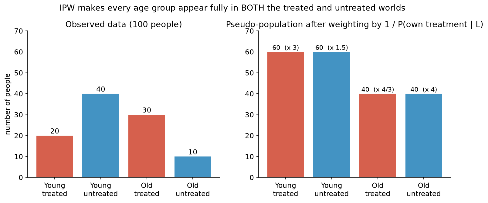
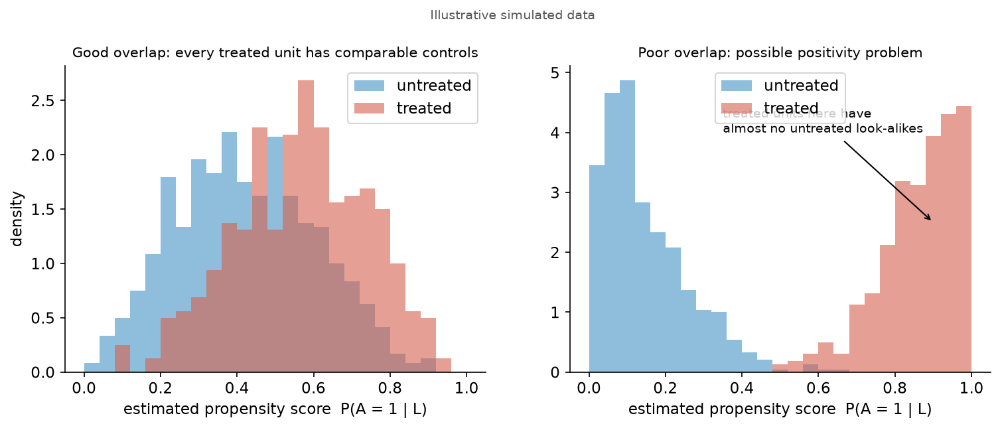

# 3. Inverse Probability Weighting (IPW) — Propensity Modeling

[← g-formula](02_standardization_g_formula.md) · [Index](README.md) · [Next: AIPW →](04_aipw_double_robustness.md)

**One-sentence idea:** instead of modeling the outcome, model **who gets treated**. Then reweight people so that the treated group (and the untreated group) each look like the **whole population**.

---

## 3.1 The propensity score

$$\boxed{\pi_i=\pi(\ell_i)=\Pr(A_i=1\mid L_i=\ell_i)}$$

The **propensity score** is the probability of being treated given your covariates. With data we estimate it, usually with logistic regression:
$$\hat\pi_i=\hat P(A=1\mid L=\ell_i)=\text{logit}^{-1}(\hat\alpha+\hat\gamma\,\ell_i)=\frac{e^{\hat\alpha+\hat\gamma\ell_i}}{1+e^{\hat\alpha+\hat\gamma\ell_i}}$$

- $\pi_i$ = P(treated). Its complement $1-\pi_i$ = P(untreated).

---

## 3.2 Intuition: building a hypothetical world

To get $E(Y^{1})$ we want a world where **everyone** is treated. We only see some people treated, so we let each treated person "stand in" for several people like them.

From lecture (COVID vaccine example):
- **Young:** 6 people, 4 treated, so $\pi=4/6$. We want 6 treated young people but only have 4, so each counts as $6/4=1/\pi$ people.
- **Old:** 10 people, 4 treated, so $\pi=4/10$. Each treated old person counts as $10/4=1/\pi$ people.
- **Untreated young:** 2 of 6, so $P(A=0)=2/6=1-\pi$. Each counts as $6/2=1/(1-\pi)$ people.

> **General rule:** weight each person by
> $$w_i=\frac{1}{\Pr(\text{the treatment they actually got}\mid L_i)}=\begin{cases}\dfrac1{\pi_i}&\text{if }A_i=1\\[2mm]\dfrac1{1-\pi_i}&\text{if }A_i=0\end{cases}$$

### Picture: the pseudo-population

Below, 100 people: Young (60, of whom 20 treated, so $\pi=1/3$) and Old (40, of whom 30 treated, so $\pi=3/4$).

| Group | Count | $P(\text{own treatment}\mid L)$ | Weight | Weighted count |
|---|---|---|---|---|
| Young, treated | 20 | $1/3$ | 3 | 60 |
| Young, untreated | 40 | $2/3$ | 1.5 | 60 |
| Old, treated | 30 | $3/4$ | 4/3 | 40 |
| Old, untreated | 10 | $1/4$ | 4 | 40 |

After weighting, **both** the treated world and the untreated world contain 60 young and 40 old: the same age mix as the real population. Age is no longer associated with treatment, so the confounding is gone.

**Who gets big weights?** People who received the **unlikely** treatment for someone like them (a treated person with $\pi=0.2$ gets weight 5). They are rare, so each one represents many people.

---

## 3.3 The IPW formulas

$$\hat E(Y^{1})=\frac1N\sum_{i:A_i=1}\frac{Y_i}{\hat\pi_i}\qquad\qquad \hat E(Y^{0})=\frac1N\sum_{i:A_i=0}\frac{Y_i}{1-\hat\pi_i}$$

$$\boxed{\widehat{ATE}_{IPW}=\frac1N\left[\sum_{i:A_i=1}\frac{Y_i}{\hat\pi_i}-\sum_{i:A_i=0}\frac{Y_i}{1-\hat\pi_i}\right]}$$

| Piece | Meaning |
|---|---|
| $N$ | **Total** number of people (treated + untreated), which is also the size of each hypothetical world. **Not** $n_t$! |
| $\sum_{i:A_i=1}$ | sum over treated people only |
| $Y_i/\hat\pi_i$ | treated person's outcome, up-weighted by $1/\hat\pi_i$ |
| $Y_i/(1-\hat\pi_i)$ | untreated person's outcome, up-weighted by $1/(1-\hat\pi_i)$ |

**Same thing written as a sum over everyone** (using $A_i$ as an on/off switch):
$$\widehat{ATE}_{IPW}=\frac1N\sum_{i=1}^N\left[\frac{A_iY_i}{\hat\pi_i}-\frac{(1-A_i)Y_i}{1-\hat\pi_i}\right]$$
For a treated person $A_i=1$ the second term vanishes; for an untreated person $A_i=0$ the first term vanishes.

---

## 3.4 Worked example: IPW gives the same answer as standardization

Same 100 people as above. Mean outcomes: young treated 10, young untreated 6, old treated 20, old untreated 12.

**IPW:**
$$\hat E(Y^1)=\frac1{100}\Big[\underbrace{20\times3\times10}_{\text{young treated}}+\underbrace{30\times\tfrac43\times20}_{\text{old treated}}\Big]=\frac{600+800}{100}=14$$
$$\hat E(Y^0)=\frac1{100}\Big[\underbrace{40\times1.5\times6}_{\text{young untreated}}+\underbrace{10\times4\times12}_{\text{old untreated}}\Big]=\frac{360+480}{100}=8.4$$
$$\widehat{ATE}=14-8.4=\mathbf{5.6}$$

**Standardization:** $E(Y^1)=10(0.6)+20(0.4)=14$; $E(Y^0)=6(0.6)+12(0.4)=8.4$; ATE = **5.6**. ✅ Same.

> When the predictions are exactly right ($\hat E=E$, $\hat\pi=\pi$), standardization and IPW are **equivalent**. With real models they can give different numbers.

---

## 3.5 Step-by-step recipe for a quiz table

Given columns $A_i$, $Y_i$, $\hat\pi_i$:

1. For each **treated** row: compute $Y_i/\hat\pi_i$.
2. For each **untreated** row: compute $Y_i/(1-\hat\pi_i)$.
3. Add up the treated terms, add up the untreated terms, subtract.
4. Divide by $N$ = **total** rows.

**Practice quiz table** ($N=4$):

| $i$ | $A_i$ | $Y_i$ | $\hat\pi_i$ | term |
|---|---|---|---|---|
| 1 | 1 | 210 | .5 | $210/.5=420$ |
| 2 | 1 | 160 | .8 | $160/.8=200$ |
| 3 | 0 | 60 | .2 | $60/(1-.2)=75$ |
| 4 | 0 | 70 | .3 | $70/(1-.3)=100$ |

$$\widehat{ATE}_{IPW}=\tfrac14\big[(420+200)-(75+100)\big]=\tfrac14(445)=\mathbf{111.25}$$

### ⚠️ Common traps in multiple choice
| Trap | Why it's wrong |
|---|---|
| $60/.2$ for an untreated person | Untreated people are weighted by $1/(1-\hat\pi)$, **not** $1/\hat\pi$. |
| $210/(1-.5)$ for a treated person | Treated people use $1/\hat\pi$. (Here .5 hides the mistake, but $160/(1-.8)=800$ would be wrong.) |
| Dividing by $n_t$ and $n_c$ separately | The slides' estimator divides **both** sums by the total $N$. |
| A minus sign *inside* the untreated sum | The untreated terms are **added together** and then the whole sum is subtracted: $-(a+b)$, not $-(a-b)$. |

---

## 3.6 Weaknesses of IPW

- **Needs a correct propensity model.** If $\hat\pi$ is wrong (e.g. treatment depends on $L$ in a complicated way you modeled linearly), IPW is biased.
- **Positivity problems lead to extreme weights.** If some $\hat\pi_i$ is near 0 (for a treated person) or near 1 (for an untreated person), the weight $1/\hat\pi$ or $1/(1-\hat\pi)$ is huge. One person dominates and the variance explodes.

---

## 3.7 g-formula vs IPW: when to use which (slides)

| | g-formula / standardization | IPW |
|---|---|---|
| Models | the **outcome** $E(Y\mid A,L)$ | the **treatment** $P(A=1\mid L)$ |
| Use when… | **outcomes are easier to predict** than treatment status | **treatment is easier to predict** than outcomes |
| Fails when… | outcome model misspecified | propensity model misspecified |
| Popularity | probably more popular, *"but not inherently better"* | |

**Quiz example (Q3a):** "$E(Y\mid A,I,E)$ is linear, but $P(A\mid I,E)$ is very complex." Then the **outcome** is easy to model, so use **standardization / g-formula**.

[Next: AIPW →](04_aipw_double_robustness.md)
