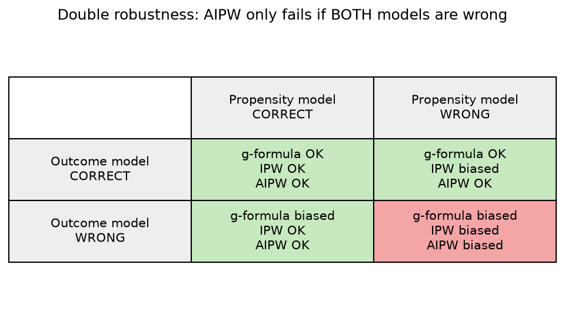

# 4. Augmented IPW (AIPW) and Double Robustness

[← IPW](03_ipw.md) · [Index](README.md) · [Next: Bias–variance →](05_bias_variance_model_choice.md)

**One-sentence idea:** combine the outcome model **and** the propensity model so you get **two shots** at being right. AIPW is correct if **either** model is correct.

---

## 4.1 The formula

$$\hat E(Y^{1})=\frac1N\Bigg[\underbrace{\sum_i\hat E(Y\mid A=1,L=\ell_i)}_{\text{g-computation}}+\underbrace{\sum_i\frac{A_iY_i}{\hat\pi_i}}_{\text{IPW}}-\underbrace{\sum_i\frac{A_i}{\hat\pi_i}\hat E(Y\mid A=1,L=\ell_i)}_{\text{new "correction" term}}\Bigg]$$

$$\hat E(Y^{0})=\frac1N\Bigg[\sum_i\hat E(Y\mid A=0,L=\ell_i)+\sum_i\frac{(1-A_i)Y_i}{1-\hat\pi_i}-\sum_i\frac{1-A_i}{1-\hat\pi_i}\hat E(Y\mid A=0,L=\ell_i)\Bigg]$$

$$\widehat{ATE}_{AIPW}=\hat E(Y^{1})-\hat E(Y^{0})$$

### Easier-to-remember per-person form
Group the last two terms:

$$\hat E(Y^1)=\frac1N\sum_i\Big[\underbrace{\hat E(Y\mid A=1,\ell_i)}_{\text{prediction}}+\underbrace{\frac{A_i}{\hat\pi_i}}_{\text{IPW weight}}\underbrace{\big(Y_i-\hat E(Y\mid A=1,\ell_i)\big)}_{\text{prediction error (residual)}}\Big]$$

> **AIPW = g-formula prediction + IPW-weighted correction for the prediction's mistakes.**

- If the outcome model's predictions are perfect, the residuals average to 0 and you are left with the g-formula.
- If the predictions are off, the IPW-weighted residuals **fix** the error, provided the propensity scores are right.

---

## 4.2 Why it's "doubly robust" (the proof from lecture, simplified)

Use the fact that $E(A_i\mid L_i)=\pi_i$ (the true propensity). Hold the fitted $\hat E$ and $\hat\pi$ fixed and take the expectation of one person's AIPW term:

$$E\Big[\hat E_1+\tfrac{A_i}{\hat\pi_i}(Y_i-\hat E_1)\Big]=\hat E_1+\frac{\pi_i}{\hat\pi_i}\Big[E(Y\mid A=1,\ell_i)-\hat E_1\Big]$$

where $\hat E_1$ is short for $\hat E(Y\mid A=1,L=\ell_i)$.

**Case 1: outcome model correct** ($\hat E_1=E_1$). The bracket is $E_1-E_1=0$, so the term equals $E_1$, the truth, **no matter how wrong $\hat\pi$ is**.

**Case 2: propensity model correct** ($\hat\pi_i=\pi_i$). Then $\pi_i/\hat\pi_i=1$, so the term is $\hat E_1+(E_1-\hat E_1)=E_1$, the truth, **no matter how wrong $\hat E$ is**.

**Case 3: both wrong.** Nothing cancels, so AIPW is biased.

> *"Double robustness allows a single failure."* (slides) One model can be completely wrong as long as the other one is correct.

---

## 4.3 Trade-offs

- **If the outcome model is right**, the plain g-formula often has **smaller variance** than AIPW.
- **If the outcome model is wrong**, the g-formula is biased even with huge $n$. AIPW gives **insurance** against misspecification.
- **AIPW cannot fix a missing confounder.** If $L$ is not a sufficient adjustment set, *both* models are conditioning on the wrong thing, so neither can be "correct" for the causal question.

---

## 4.4 Worked numeric example (practice quiz table)

| $i$ | $A_i$ | $Y_i$ | $\hat E(Y\mid A=1,L)$ | $\hat E(Y\mid A=0,L)$ | $\hat\pi_i$ |
|---|---|---|---|---|---|
| 1 | 1 | 210 | 180 | 100 | .5 |
| 2 | 1 | 160 | 180 | 100 | .8 |
| 3 | 0 | 60 | 80 | 60 | .2 |
| 4 | 0 | 70 | 80 | 60 | .3 |

**$\hat E(Y^1)$ terms**, computed as prediction + $\frac{A_i}{\hat\pi_i}$(residual):
- $i=1$: $180+\frac{1}{.5}(210-180)=180+60=240$
- $i=2$: $180+\frac1{.8}(160-180)=180-25=155$
- $i=3$: $80+0=80$ (untreated, so the correction is 0)
- $i=4$: $80+0=80$

$\hat E(Y^1)=\frac{240+155+80+80}{4}=138.75$

**$\hat E(Y^0)$ terms**, computed as prediction + $\frac{1-A_i}{1-\hat\pi_i}$(residual):
- $i=1$: $100+0=100$
- $i=2$: $100+0=100$
- $i=3$: $60+\frac1{.8}(60-60)=60$
- $i=4$: $60+\frac1{.7}(70-60)=60+14.29=74.29$

$\hat E(Y^0)=\frac{100+100+60+74.29}{4}=83.57$

$$\widehat{ATE}_{AIPW}=138.75-83.57\approx\mathbf{55.2}$$

Compare: g-formula ATE = 50, IPW ATE = 111.25. AIPW lands near the g-formula here because the outcome predictions are fairly close to the observed $Y$s (small residuals).

---

## 4.5 Quiz question pattern: "which method is reliable?"

Ask yourself three questions:

1. **Is the adjustment set sufficient?** If a needed confounder was left out of the models, **nothing is reliable**.
2. **Is the outcome model correctly specified?** If yes, g-formula ✅ and AIPW ✅.
3. **Is the propensity model correctly specified?** If yes, IPW ✅ and AIPW ✅.

| Scenario | g-formula | IPW | AIPW |
|---|---|---|---|
| True $E(Y\mid A,L)$ linear, fit linear; true $P(A\mid L)$ complex, fit linear | ✅ | ❌ | ✅ |
| True $E(Y\mid A,L)$ complex, fit linear; true $P(A\mid L)$ logistic, fit logistic | ❌ | ✅ | ✅ |
| Both fit correctly | ✅ | ✅ | ✅ |
| Both fit wrong | ❌ | ❌ | ❌ |
| Confounder $E$ omitted from both models | ❌ | ❌ | ❌ |

[Next: Bias–variance →](05_bias_variance_model_choice.md)
