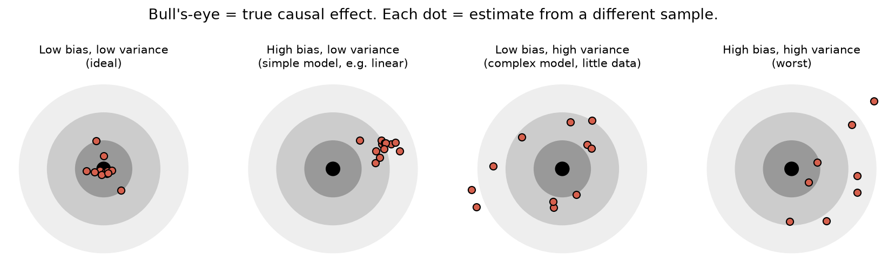
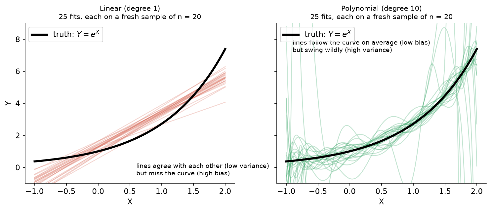
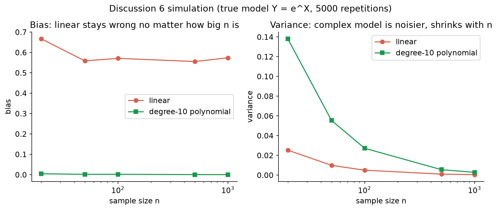

# 5. The Bias–Variance Trade-off and Choosing a Model

[← AIPW](04_aipw_double_robustness.md) · [Index](README.md) · [Next: Matching →](06_matching.md)

**One-sentence idea:** simple models are **stable but systematically wrong**; complex models are **right on average but jumpy**. More data lets you afford more complexity.

---

## 5.1 Definitions

| Term | Definition (slides) | Analogy: baking cakes |
|---|---|---|
| **Bias** | *"The functions we may estimate are not complex enough to capture the true relationship."* Your estimate is off **on average**, across many samples. | Every cake comes out the same, but it's the wrong flavor. |
| **Variance** | *"The model we are fitting is too complex, so our estimated parameters change a lot from sample to sample."* | Some cakes are perfect and some are burnt; results are inconsistent. |

Formally, for an estimator $\hat\theta$ of a truth $\theta$:
$$\text{Bias}=E(\hat\theta)-\theta\qquad\text{Variance}=E\big[(\hat\theta-E(\hat\theta))^2\big]$$
Total error (mean squared error) $=\text{Bias}^2+\text{Variance}$. You want both small, but reducing one usually increases the other.

---

## 5.2 Seeing it: linear vs complex fits

True relationship: $Y=e^X$ (a curve). We repeatedly draw a new small sample and refit each model.

Results from Discussion 6 (5,000 simulated samples at each sample size):

| $n$ | Bias: linear | Bias: degree-10 | Variance: linear | Variance: degree-10 |
|---|---|---|---|---|
| 20 | 0.6674 | 0.0047 | 0.0253 | 0.1382 |
| 50 | 0.5587 | 0.0020 | 0.0099 | 0.0554 |
| 100 | 0.5710 | 0.0021 | 0.0050 | 0.0272 |
| 500 | 0.5555 | 0.0006 | 0.0010 | 0.0055 |
| 1000 | 0.5738 | 0.0005 | 0.0005 | 0.0028 |

**Read the table like this:**
- The linear model's **bias never goes away** (≈0.56 even at n = 1000), because a line can't become a curve. That's **misspecification**.
- The complex model's **variance shrinks as n grows**. With enough data, complexity stops being dangerous.
- At small n, the complex model's variance (0.138) is much larger than the linear model's (0.025).

---

## 5.3 Rules of thumb (these are quiz answers)

| | Simple / parametric (e.g. linear regression) | Complex / nonparametric (ML, random forest, many interactions, subgroup means) |
|---|---|---|
| Bias | **High** (probably) | **Low** |
| Variance | **Low** | **High** |
| Data needed | Small samples OK | Needs **large** samples |
| Interpretability | Easy | Hard |

- *"Linear model: 1 parameter per covariate (probably high bias)."*
- *"Observed average: $2^p$ means to estimate for $p$ binary covariates (probably high variance)."*
- *"Other methods are typically somewhere in between."*
- *"**Larger sample allows for more complex models.**"*
- "More complex" can mean nonlinear relationships **or including more covariates**.

### Practice quiz Q2 template answer
> **30 data points → linear regression.** With so little data, a complex ML model would overfit: its estimates would change a lot from sample to sample (high variance). A simple model has some bias but much lower variance.
>
> **30,000 data points → the complex ML model.** With lots of data its variance becomes small, and its flexibility lets it capture nonlinear relationships that a linear model would miss (lower bias).

---

## 5.4 Bias–variance in choosing the causal model (DAG)

- Is a DAG ever "truly correct"? You can always add more confounders.
- Ask whether the bias from the confounders you **could** add would substantially change your claim.
- **Including additional confounders makes estimation more difficult** (more dimensions means more variance, and the curse of dimensionality) and requires a larger sample.

---

## 5.5 Bias–variance shows up in matching too

| Choice | Lower bias | Lower variance |
|---|---|---|
| 1:1 vs k:1 | **1:1** (only best matches) | **k:1** (average over more controls) |
| With vs without replacement | **With** (each treated unit gets its best match) | **Without** (more distinct controls used) |
| Caliper vs none | **Caliper** (drops bad matches) | No caliper (keeps more units) |

Details in [File 6](06_matching.md).

[Next: Matching →](06_matching.md)
