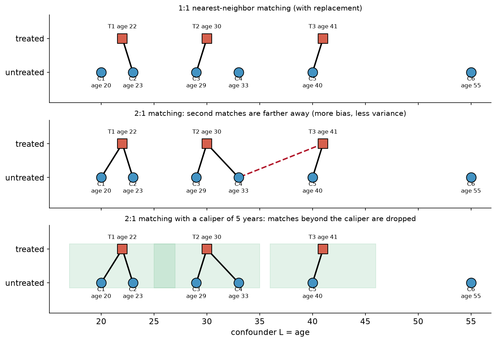
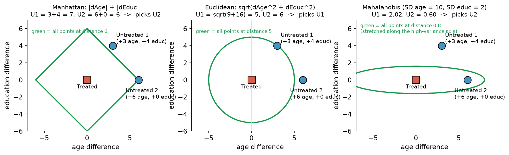
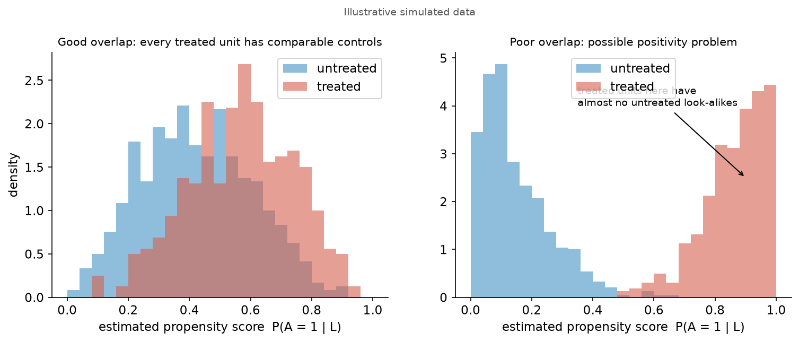
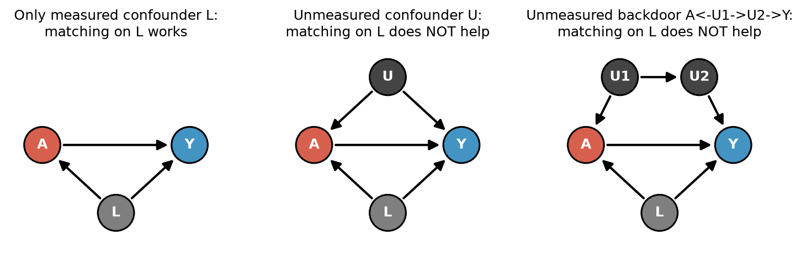

# 6. Matching

[← Bias–variance](05_bias_variance_model_choice.md) · [Index](README.md) · [Next: Practice quiz solutions →](07_practice_quiz_solutions.md)

**One-sentence idea:** for each treated person, find untreated people who **look like them** on the confounders, and use those look-alikes' outcomes as the treated person's missing $Y^0$.

---

## 6.1 What matching estimates: the ATT

$$ATT=E(Y^{1}\mid A=1)-E(Y^{0}\mid A=1)$$

- **First term (easy):** by consistency, treated people's observed outcomes *are* their $Y^1$:
 $E(Y^1\mid A=1)\approx\frac1{n_t}\sum_{i:A_i=1}Y_i$
- **Second term (hard):** $E(Y^0\mid A=1)$ is the treated people's outcome *had they not been treated*.
 $\frac1{n_c}\sum_{A_i=0}Y_i$ is **not** a good estimate, because the controls differ from the treated in $L$.

**Matching solution:** for each treated $i$, find a set $M_i$ of similar untreated units and average their outcomes:

$$E(Y^0\mid A=1)\approx\frac1{n_t}\sum_{i:A_i=1}\Bigg(\underbrace{\frac1{|M_i|}\sum_{j\in M_i}Y_j}_{\text{avg of }i\text{'s matches}}\Bigg)
\qquad\Rightarrow\qquad
\boxed{\widehat{ATT}=\frac1{n_t}\sum_{i:A_i=1}\Big(Y_i-\frac1{|M_i|}\sum_{j\in M_i}Y_j\Big)}$$

**Why it works:** if conditional exchangeability holds given $L$ (e.g. age), then for a 35-year-old treated person
$$\underbrace{E(Y^0\mid A=1,\text{Age}=35)}_{\text{can't estimate directly}}=\underbrace{E(Y^0\mid A=0,\text{Age}=35)}_{\text{can estimate from untreated 35-year-olds}}$$

> Matching can be seen as an **outcome-modeling** strategy: $E(Y\mid A=0, L=\ell_i)$ is estimated by the mean outcome of controls with $L$ close to $\ell_i$. (course website)

---

## 6.2 Why matching is great (slides)

1. Completely transparent that $Y^1_i$ is observed.
2. Easy to explain: we had treated units, found comparable controls, and compared means.
3. **You can assess the quality of the matches before looking at the outcome.**
4. "Model-free"\*. \*But you have to define what makes a match "good".

---

## 6.3 Univariate matching algorithms: four choices, each a bias–variance trade-off



| Choice | Option A | Option B | Trade-off |
|---|---|---|---|
| **Caliper** | No caliper: always match | **Caliper**: a maximum distance; drop a treated unit rather than match beyond it | Caliper means **lower bias**, but you now estimate the **FSATT** (feasible sample ATT: only treated units with an acceptable match). Poor matches may signal a **positivity violation**. |
| **Ratio** | **1:1**: one control per treated | **k:1**: k controls per treated | 1:1 has **lower bias** (only the best match). k:1 has **lower variance** (averaging more cases). *"Greater k → lower variance, higher bias."* |
| **Replacement** | **With replacement**: a control can be reused | **Without replacement**: each control used at most once | With replacement has **lower bias** (better matches). Without replacement has **lower variance** (more distinct controls). |
| **Search** | **Greedy**: match treated units one at a time, each grabs its best available control | **Optimal**: minimize the total distance over all matches at once | *"Optimal is better. Just computationally harder."* Greedy can give early units good matches and leave later units with bad ones. |

*"Many reasonable choices; good choices depend on the data you have."*

### Worked example: 1:1 vs 2:1 (data from the figure)

| Treated | Age | $Y$ | | Control | Age | $Y$ |
|---|---|---|---|---|---|---|
| T1 | 22 | 30 | | C1 | 20 | 25 |
| T2 | 30 | 45 | | C2 | 23 | 28 |
| T3 | 41 | 50 | | C3 | 29 | 38 |
| | | | | C4 | 33 | 40 |
| | | | | C5 | 40 | 47 |
| | | | | C6 | 55 | 60 |

**1:1 nearest neighbor (with replacement):**
| Treated | Match | Distance | $Y_i-Y_{\text{match}}$ |
|---|---|---|---|
| T1 (22) | C2 (23) | 1 | 30 − 28 = 2 |
| T2 (30) | C3 (29) | 1 | 45 − 38 = 7 |
| T3 (41) | C5 (40) | 1 | 50 − 47 = 3 |

$\widehat{ATT}_{1:1}=(2+7+3)/3=\mathbf{4.0}$

**2:1 matching (two nearest controls each):**
| Treated | Matches (distance) | Avg match $Y$ | Difference |
|---|---|---|---|
| T1 | C2 (1), C1 (2) | (28+25)/2 = 26.5 | 3.5 |
| T2 | C3 (1), C4 (3) | (38+40)/2 = 39 | 6 |
| T3 | C5 (1), **C4 (8)** | (47+40)/2 = 43.5 | 6.5 |

$\widehat{ATT}_{2:1}=(3.5+6+6.5)/3\approx\mathbf{5.33}$

T3's second match is 8 years away. That's the **extra bias** of k:1. But each estimate now averages 2 outcomes instead of 1, which is the **lower variance**. With a **caliper of 5 years**, C4 is dropped from T3's set.

---

## 6.4 Multivariate matching: you need a distance metric

With several confounders (e.g. age **and** education), "closest" depends on how you measure distance.



### The metrics

| Metric | Formula | Notes |
|---|---|---|
| **Exact** | $d(i,j)=0$ if $\ell_i=\ell_j$, $\infty$ otherwise | Ideal, but the **curse of dimensionality** often means **no matches at all**. |
| **Coarsened exact (CEM)** | Exact match on coarsened $\tilde L$ (e.g. age bins 15–20, 20–25, …) | ✅ very transparent; ✅ directly targets balance in $L$; ❌ must choose the buckets; ❌ may still find no match for many people. |
| **Manhattan** | $d(i,j)=\sum_p\lvert L_{pi}-L_{pj}\rvert$ | Sum of absolute differences ("city blocks"). Unit-dependent. |
| **Euclidean** | $d(i,j)=\sqrt{\sum_p(L_{pi}-L_{pj})^2}$ | Straight-line distance. Unit-dependent. |
| **Mahalanobis** | $d(i,j)=\sqrt{(\vec L_i-\vec L_j)^T\,\Sigma^{-1}\,(\vec L_i-\vec L_j)}$ | $\Sigma=V(\vec L)$ is the variance–covariance matrix. Scale-free and correlation-aware. |
| **Propensity score** | $d(i,j)=\lvert\hat\pi_i-\hat\pi_j\rvert$ | One-number summary of all covariates. Most popular. |

### Slide example: Manhattan vs Euclidean disagree
Treated vs Untreated 1: (+3 age, +4 educ). Treated vs Untreated 2: (+6 age, +0 educ).

| | Untreated 1 | Untreated 2 | Picks |
|---|---|---|---|
| Manhattan | 3 + 4 = 7 | 6 + 0 = **6** | U2 |
| Euclidean | $\sqrt{9+16}=$ **5** | $\sqrt{36}=6$ | U1 |
| Mahalanobis (SD age 10, SD educ 2, uncorrelated) | $\sqrt{(3/10)^2+(4/2)^2}=2.02$ | $\sqrt{(6/10)^2}=$ **0.60** | U2 |

*"Which individual to pick depends on the distance metric!"*

### Mahalanobis: two principles
1. **Unequal variances.** Age might range from 18 to 80 while education ranges from 0 to 16. Without correction, the variable with the bigger spread **dominates** the distance. Mahalanobis divides each difference by that variable's spread.
2. **Correlations.** If you include age in years **and** age in months (almost perfectly correlated), Euclidean and Manhattan count "age" twice. Mahalanobis corrects for correlation so redundant information isn't double-counted.

When the covariates are uncorrelated, Mahalanobis reduces to Euclidean distance on **standardized** variables:
$$d(i,j)=\sqrt{\sum_p\frac{(L_{pi}-L_{pj})^2}{\sigma_p^2}}$$

#### 💡 Quiz Q5 example: income (USD) and education (years)
Treated: \$50,000, 12 yrs. U1: \$50,500, 20 yrs. U2: \$52,000, 12 yrs.
- **Manhattan:** U1 = 500 + 8 = **508**, U2 = 2000 + 0 = 2000, so it picks **U1**, even though U1 has 8 more years of education! A \$1 difference counts the same as a 1-year difference, so income swamps education.
- **Mahalanobis** (say SD income = \$20,000, SD educ = 3 yrs): U1 = $\sqrt{(500/20000)^2+(8/3)^2}\approx2.67$, U2 = $\sqrt{(2000/20000)^2}=0.10$, so it picks **U2** (the sensible match).

---

## 6.5 Propensity score matching (PSM)



If $L$ affects $A$ **only through** the probability of treatment $\pi(\ell)=P(A=1\mid L=\ell)$, then **conditional exchangeability also holds given $\pi(\ell_i)$ alone**. So we can match on one number instead of many covariates.

**Why propensity scores are nice (slides):**
- Match on a single number, which avoids the curse of dimensionality.
- Easy to reason about; you can **visualize** the univariate matches.
- **Intuitive: prioritizes covariates that predict treatment.**
- Mathematical guarantee, *on average*: if the DAG is right and matches are good,
 $$P(L\mid\pi_i,A_i=1)=P(L\mid\pi_i,A_i=0)$$
 i.e. treated and matched controls have the same covariate distribution.

**Caveat:** balance holds only **on average**. Two people with $\hat\pi=0.4$ may have very different $L$s.

### PSM vs CEM (practice quiz Q6)
| | Coarsened exact matching | Propensity score matching |
|---|---|---|
| Matches on | All covariates (coarsened) at once | One number, $\hat\pi$ |
| With 30 covariates | Number of cells = (bins)$^{30}$, astronomically many. Most treated units have **no match** and get dropped. | Still one dimension, so matches are almost always available. |
| Covariate importance | Treats every covariate equally (must match exactly on all) | Automatically weights covariates by how strongly they predict treatment |
| Balance | Exact within buckets (very transparent) | On average |

> **Template answer:** With 30 covariates, CEM suffers from the curse of dimensionality: there are so many coarsened cells that most treated units won't have an exact match, so they get dropped (or the bins must be so coarse that matches are poor). Propensity score matching collapses all 30 covariates into a single score $P(A=1\mid L)$, so matches are easy to find, and it automatically emphasizes the covariates that matter most for treatment.

---

## 6.6 Evaluate the matched sets (always!)

Whatever method you use, **check that it worked**:
- Compare means of $L$ (and of the propensity scores) between treated and matched controls.
- Possibly compare interaction cells (e.g. race × age).
- Visually check distributions (histograms/density plots).
- **Lack of overlap may indicate a violation of positivity.**

In R (`MatchIt`), from the course worked example:
```r
matched <- matchit(a == "college" ~ sex + race + mom_educ + dad_educ +
                     log_parent_income + log_parent_wealth + test_percentile,
                   method = "nearest", distance = "glm", estimand = "ATT", data = d)
# 1,533 college grads matched to 1,533 non-grads; 4,705 non-grads unused (weight 0)
# P(college spouse): college 0.528 vs matched non-college 0.232
```

---

## 6.7 Estimating the effect after matching

- If matches are good: **compare means** of the treated group (with a match) and the matched control group.
- Be extra careful by **combining regression + matching**: fit a regression on the matched sample to adjust for leftover differences (matches are never perfect).
  - If everything is perfect, either method alone is fine.
  - Combining can **reduce bias** and **reduce model sensitivity**.
- Course example: means only gave 0.528 − 0.232 ≈ 0.296; matching + regression gave 0.528 − 0.259 = **0.269**.

---

## 6.8 ⚠️ Warning: matching is estimation, not identification



*"Matching is an estimation strategy. It does not solve identification problems."* If there is an **unmeasured confounder** $U$, matching on $L$ leaves the backdoor through $U$ open, and the estimate is still biased, no matter how good the matches look.

[Next: Practice quiz solutions →](07_practice_quiz_solutions.md)
