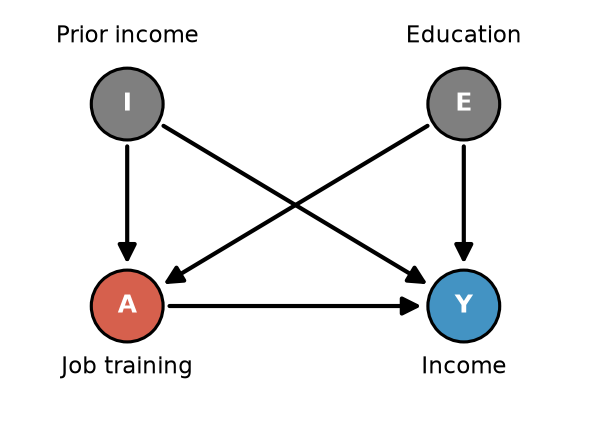

# 7. Practice Quiz #3: Full Worked Solutions

[← Matching](06_matching.md) · [Index](README.md) · [Next: Extra practice →](08_extra_practice.md)

Try each question yourself first, then open the solution. Every answer explains **why** the other options are wrong.

---

## Question 1: Estimating from a prediction table

We have conditional exchangeability given $L$.

| Individual | $A_i$ | $Y_i$ | $\hat E(Y\mid A=1,L)$ | $\hat E(Y\mid A=0,L)$ | $\hat\pi_i$ |
|---|---|---|---|---|---|
| 1 | 1 | 210 | 180 | 100 | .5 |
| 2 | 1 | 160 | 180 | 100 | .8 |
| 3 | 0 | 60 | 80 | 60 | .2 |
| 4 | 0 | 70 | 80 | 60 | .3 |

**First, decode the table:**
- Rows 1–2 are **treated** ($A=1$); rows 3–4 are **untreated** ($A=0$). So $N=4$, $n_t=2$.
- $\hat E(Y\mid A=1,L)$ = predicted outcome **if treated** (for everyone, including untreated rows).
- $\hat E(Y\mid A=0,L)$ = predicted outcome **if untreated** (for everyone).
- $\hat\pi_i$ = estimated probability of treatment.

### (a) ATT via the g-formula

Options:
1. $\tfrac12(180+180)-\tfrac12(100+100)$
2. $\tfrac14(210+160+60+70)-\tfrac14(180+180+80+80)$
3. $\tfrac14(180+180+80+80)-\tfrac14(100+100+60+60)$
4. $\tfrac14(210+210+60+70+70)-\tfrac14(180+180+80+80)$
5. $\tfrac12(80+80)-\tfrac12(60+60)$

<b>Show solution</b>

**Answer: option 1, $\tfrac12(180+180)-\tfrac12(100+100)=180-100=80$**

ATT means **average over the treated only** (rows 1 and 2, so divide by $n_t=2$), using predicted-if-treated minus predicted-if-untreated:
$$\widehat{ATT}=\frac1{n_t}\sum_{i:A_i=1}\big[\hat E(Y\mid A=1,\ell_i)-\hat E(Y\mid A=0,\ell_i)\big]=\tfrac12(180+180)-\tfrac12(100+100)$$

Why not the others:
- Option 3 averages over **all four** people, which is the ATE.
- Option 5 averages over the **untreated** rows (3, 4), which is the effect on the untreated.
- Options 2 and 4 compare **observed** $Y$ to predicted-if-treated. That isn't a treated vs untreated contrast, and option 4 even repeats values.

### (b) ATE via the g-formula

<b>Show solution</b>

**Answer: option 3, $\tfrac14(180+180+80+80)-\tfrac14(100+100+60+60)=130-80=50$**

ATE means **average over everyone** ($N=4$):
$$\widehat{ATE}=\frac1N\sum_{i=1}^{N}\hat E(Y\mid A=1,\ell_i)-\frac1N\sum_{i=1}^{N}\hat E(Y\mid A=0,\ell_i)$$
Take all four numbers in the "if treated" column minus all four in the "if untreated" column.

### (c) ATE via IPW

Options (as printed):
1. $\tfrac14[(210/.5+160/.8)-(60/(1-.2)-70/(1-.3)]$
2. $\tfrac14[(210/.5+160/.8)-(60/.2-70/.3)]$
3. $\tfrac14[(210/(1-.5)+160/(1.8)-(60/(1-.2)+70/(1-.3)]$
4. $\tfrac14[(210/(1-.5)+160/(1-.8)-60/.2+70/.3]$

<b>Show solution</b>

**Answer: option 1**, the only one with the correct weights: treated divided by $\hat\pi$, untreated divided by $1-\hat\pi$, all over $N=4$.

$$\widehat{ATE}_{IPW}=\frac1N\left[\sum_{A_i=1}\frac{Y_i}{\hat\pi_i}-\sum_{A_i=0}\frac{Y_i}{1-\hat\pi_i}\right]=\tfrac14\Big[\Big(\tfrac{210}{.5}+\tfrac{160}{.8}\Big)-\Big(\tfrac{60}{.8}+\tfrac{70}{.7}\Big)\Big]$$
$$=\tfrac14\big[(420+200)-(75+100)\big]=\tfrac{445}{4}=\mathbf{111.25}$$

⚠️ The printed option 1 shows a minus sign between the two untreated terms. That looks like a typo: correctly, the untreated terms are **added** and then the total is subtracted. It is still the only option with the right weights.

Why not the others:
- Option 2 divides untreated outcomes by $\hat\pi$ (should be $1-\hat\pi$).
- Options 3 and 4 divide treated outcomes by $1-\hat\pi$ (should be $\hat\pi$).

**Side note:** the g-formula gave 50 and IPW gave 111.25. With finite data and imperfect models, the two estimators don't have to agree (AIPW gives ≈ 55.2, see [File 4](04_aipw_double_robustness.md)).

---

## Question 2: Linear regression vs complex ML with 30 vs 30,000 data points

<b>Show solution</b>

- **30 data points: linear regression.** A complex ML model would overfit the small sample: its estimates would change a lot from sample to sample (**high variance**). The linear model may be somewhat biased, but its variance is much lower.
- **30,000 data points: complex ML model.** With a large sample, the variance of the complex model is small, and its flexibility captures nonlinear relationships that a linear model would miss (**lower bias**).

Key phrase: *"Larger sample allows for more complex models."*

---

## Question 3: Choosing among IPW, g-formula, and AIPW

DAG: Prior income $I$ and Education $E$ each cause Job training $A$ and Income $Y$; $A\to Y$. The sufficient adjustment set is $\{I,E\}$. (The printed quiz has typos, "$C$" and "$M$"; read them as $I$.)

### (a) $E(Y\mid A,I,E)$ is linear, but $P(A\mid I,E)$ is very complex. More reliable: IPW or standardization?

<b>Show solution</b>

**Answer: Standardization / g-formula.**

The outcome model is easy to specify correctly (it's linear), while the propensity model is hard to get right. Use the method that relies on the model you can get right. *"If outcomes are easier to predict than treatment status, use standardization."*

### (b) Same truth. We fit **linear** regressions for both $P(A\mid I,E)$ and $E(Y\mid A,I,E)$. Which are reliable? (choose all)

<b>Show solution</b>

**Answer: Standardization / g-formula AND AIPW.**

| Model | True form | Fitted form | Correct? |
|---|---|---|---|
| Outcome $E(Y\mid A,I,E)$ | linear | linear | ✅ |
| Propensity $P(A\mid I,E)$ | very complex | linear | ❌ misspecified |

- g-formula uses only the outcome model, which is correct: ✅
- IPW uses only the propensity model, which is wrong: ❌
- AIPW needs **either** model correct: ✅ (double robustness)

### (c) Same truth. We fit linear regressions for $P(A\mid I)$ and $E(Y\mid A,I)$, **leaving out education $E$** from both. Which are reliable?

<b>Show solution</b>

**Answer: none of them.**

$E$ is a **confounder** ($E\to A$ and $E\to Y$). Leaving it out of both models leaves the backdoor path $A\leftarrow E\to Y$ **open**, so conditional exchangeability given $\{I\}$ alone fails. That's an **identification** problem, and no estimator can fix it:
- g-formula: the outcome model is missing a confounder, so ❌
- IPW: the propensity model is missing a confounder, so ❌
- AIPW: **both** models are wrong, so double robustness doesn't help ❌

Remember: *"Matching [and modeling] is an estimation strategy. It does not solve identification problems."*

---

## Question 4: 1-to-1 vs 5-to-1 matching

### (a) Which has higher bias?   (b) Which has higher variance?

<b>Show solution</b>

**(a) Higher bias: 5 to 1.** The 2nd through 5th nearest controls are farther from the treated unit on $L$, so they're worse look-alikes.

**(b) Higher variance: 1 to 1.** Each treated unit's counterfactual is estimated from a single control's outcome, while 5:1 averages over 5 outcomes, which is less noisy.

*"Greater k → lower variance, higher bias."*

---

## Question 5: Why is Mahalanobis distance better than Manhattan for (current income in USD, years of education)?

<b>Show solution</b>

Manhattan distance adds the raw differences, $|\Delta\text{income}|+|\Delta\text{educ}|$, so it depends on the **units**. Income in dollars varies by thousands, while education varies by only a few years. Income therefore **dominates** the distance: a \$500 gap would outweigh an 8-year education gap, so we could match people with very different education.

Mahalanobis distance, $\sqrt{(\vec L_i-\vec L_j)^T\Sigma^{-1}(\vec L_i-\vec L_j)}$, **rescales each variable by its variance**, so both covariates count on a comparable scale. It also **accounts for the correlation** between income and education, so overlapping information isn't double-counted.

(Numeric illustration in [File 6, section 6.4](06_matching.md#64-multivariate-matching-you-need-a-distance-metric).)

---

## Question 6: Why might propensity score matching be preferred over coarsened exact matching with 30 covariates that have varying effects on treatment?

<b>Show solution</b>

- **Curse of dimensionality:** CEM requires an exact match on the coarsened version of **all 30** covariates. Even with only 2–3 bins each, that's $2^{30}$ (over a billion) or more cells, so most treated units have no match and get dropped (or the bins must be made so coarse that the matches are poor).
- **Propensity score matching** collapses all 30 covariates into **one number**, $\hat\pi=P(A=1\mid L)$, so close matches are easy to find. Under our DAG, conditional exchangeability given $\pi(L)$ holds, and matched groups are balanced on $L$ on average.
- **Varying importance:** the propensity score automatically **weights covariates by how strongly they predict treatment**, whereas CEM treats every covariate as equally important.

---

## Question 7
Name someone in your project group. (Not graded content.)

[Next: Extra practice →](08_extra_practice.md)
