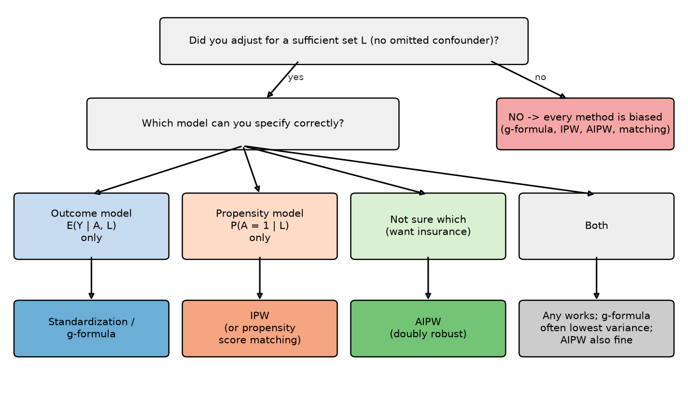

# Quiz 3 Study Guide — STSCI / INFO / ILRST 3900 Causal Inference

**Quiz 3: Thursday, Nov 5, 2026 (in class)**

Quiz 3 covers **Module 5: Statistical modeling** (lectures Oct 15 – Oct 29, discussions 6 and 7). The material is built from the course website [causal3900.github.io](https://causal3900.github.io/statistical-modeling.html) and these slide decks:

| Date | Deck | What it covers |
|---|---|---|
| Oct 15 | *Starting to think about data* (`WhyModel_26.pdf`) | Identification vs estimation, curse of dimensionality, why we need models |
| Oct 20 | *Statistical modeling* (`5-2_statistical_modeling.pdf`) | Parametric g-formula, bias–variance, IPW with a model |
| Oct 21 | *Discussion 6: Parametric g-formula* | Worked g-formula example, logistic regression, bias–variance simulation |
| Oct 22 | *Propensity modeling* (`5-3_propensity_modeling.pdf`) | IPW, standardization vs IPW, **AIPW / double robustness** |
| Oct 27 | *Matching intro* (`5-4_matching_intro.pdf`) | ATT, matching, caliper, 1:1 vs k:1, replacement, greedy vs optimal |
| Oct 28 | *Discussion 7: Matching lab* | Distance metrics: Manhattan, Euclidean, **Mahalanobis** |
| Oct 29 | *Matching continued* (`5-5_matching_cont.pdf`) | Exact matching, **coarsened exact matching**, **propensity score matching**, balance checks |
| Earlier | `2-3_standardization`, `2-4_ipw` | Foundations that quiz 3 builds on |

---

## How to use this guide

Work through the files in order. Each one has definitions, formulas with every symbol explained, pictures, and worked examples.

| # | File | Read it for |
|---|---|---|
| 1 | [01_glossary_and_foundations.md](01_glossary_and_foundations.md) | Every stats/causal term you need, defined in plain English |
| 2 | [02_standardization_g_formula.md](02_standardization_g_formula.md) | Outcome modeling: how to compute ATE and ATT from a prediction table |
| 3 | [03_ipw.md](03_ipw.md) | Inverse probability weighting: how to compute ATE from propensity scores |
| 4 | [04_aipw_double_robustness.md](04_aipw_double_robustness.md) | AIPW, and which method is reliable when a model is wrong |
| 5 | [05_bias_variance_model_choice.md](05_bias_variance_model_choice.md) | Simple vs complex models, small vs large samples |
| 6 | [06_matching.md](06_matching.md) | Matching algorithms, distance metrics, propensity score matching vs CEM |
| 7 | [07_practice_quiz_solutions.md](07_practice_quiz_solutions.md) | **Full worked solutions to the official practice quiz** |
| 8 | [08_extra_practice.md](08_extra_practice.md) | New practice problems with hidden answers |

> **Viewing tip:** open a file in Cursor and press `Ctrl+Shift+V` (Markdown preview) so the math and images render.

---

## What the quiz asks (from the practice quiz)

| Question type | Skill tested | Where to learn it |
|---|---|---|
| Pick the formula for the **ATT via g-formula** from a table | Average the predicted effect over **treated units only** | File 2 |
| Pick the formula for the **ATE via g-formula** | Average predicted $\hat E(Y\mid A=1,L)$ minus $\hat E(Y\mid A=0,L)$ over **everyone** | File 2 |
| Pick the formula for the **ATE via IPW** | Treated: $Y/\hat\pi$; untreated: $Y/(1-\hat\pi)$; divide by **total** $N$ | File 3 |
| Simple vs complex model with 30 vs 30,000 data points | Bias–variance trade-off | File 5 |
| IPW vs g-formula vs AIPW when one model is wrong or a confounder is omitted | Double robustness, identification | File 4 |
| 1:1 vs 5:1 matching: which has more bias or variance? | Matching bias–variance | File 6 |
| Why Mahalanobis beats Manhattan distance | Scale (units) and correlation | File 6 |
| Why propensity score matching beats CEM with 30 covariates | Curse of dimensionality | File 6 |

---

## One-page cheat sheet

### The three assumptions that let us use data at all
| Assumption | Formula | Meaning |
|---|---|---|
| **Conditional exchangeability** | $Y^a \perp\!\!\!\perp A \mid L$ | Within levels of $L$, treatment is "as good as random" |
| **Consistency** | If $A_i=a$ then $Y_i = Y_i^a$ | The observed outcome *is* the potential outcome under the treatment received |
| **Positivity** | $0 < P(A=1\mid L=\ell) < 1$ | Every type of person has some chance of each treatment |

### Estimators (memorize these)

**g-formula / standardization (outcome model)**
$$\hat E(Y^a)=\frac1n\sum_{i=1}^n \hat E(Y\mid A=a,\,L=\ell_i)
\qquad
\widehat{ATE}=\frac1n\sum_{i=1}^n\Big[\hat E(Y\mid A=1,\ell_i)-\hat E(Y\mid A=0,\ell_i)\Big]$$

**ATT via g-formula:** use the same formula but **average only over the treated** ($n_t$ = number treated)
$$\widehat{ATT}=\frac1{n_t}\sum_{i:A_i=1}\Big[\hat E(Y\mid A=1,\ell_i)-\hat E(Y\mid A=0,\ell_i)\Big]$$

**IPW (propensity model)**, with $\hat\pi_i=\hat P(A=1\mid L=\ell_i)$:
$$\widehat{ATE}=\frac1N\left[\sum_{i:A_i=1}\frac{Y_i}{\hat\pi_i}-\sum_{i:A_i=0}\frac{Y_i}{1-\hat\pi_i}\right]\qquad N=\text{everyone}$$

**AIPW (both models; doubly robust)**
$$\hat E(Y^1)=\frac1N\sum_i\left[\hat E(Y\mid A=1,\ell_i)+\frac{A_i}{\hat\pi_i}\Big(Y_i-\hat E(Y\mid A=1,\ell_i)\Big)\right]$$
$$\hat E(Y^0)=\frac1N\sum_i\left[\hat E(Y\mid A=0,\ell_i)+\frac{1-A_i}{1-\hat\pi_i}\Big(Y_i-\hat E(Y\mid A=0,\ell_i)\Big)\right]$$

**Matching (estimates the ATT)**
$$\widehat{ATT}=\frac1{n_t}\sum_{i:A_i=1}\Big(Y_i-\frac{1}{|M_i|}\sum_{j\in M_i}Y_j\Big)$$

### Which method is reliable?
| Situation | g-formula | IPW | AIPW |
|---|---|---|---|
| Outcome model right, propensity model wrong | ✅ | ❌ | ✅ |
| Propensity model right, outcome model wrong | ❌ | ✅ | ✅ |
| Both right | ✅ | ✅ | ✅ |
| Both wrong, **or a confounder left out of both** | ❌ | ❌ | ❌ |

### Bias–variance one-liners
- **Simple model** (linear): high bias, low variance. Use it with **small n**.
- **Complex model** (ML, random forest): low bias, high variance. Use it with **large n**.
- **1:1 matching**: lower bias, higher variance. **k:1 matching** (k > 1): higher bias, lower variance.
- **With replacement**: lower bias (better matches), higher variance. **Without replacement**: higher bias, lower variance.
- **Caliper**: lower bias. It drops treated units with bad matches, so it estimates the FSATT.
- **Optimal matching** is better than greedy matching, just slower to compute.

### Distances for matching
| Distance | Formula | Weakness / strength |
|---|---|---|
| Manhattan | $\sum_p \lvert L_{pi}-L_{pj}\rvert$ | Depends on units; a big-unit variable (income in \$) dominates |
| Euclidean | $\sqrt{\sum_p (L_{pi}-L_{pj})^2}$ | Same unit problem |
| **Mahalanobis** | $\sqrt{(\vec L_i-\vec L_j)^T\Sigma^{-1}(\vec L_i-\vec L_j)}$ | Rescales by variance and corrects for correlation |
| Exact | 0 if identical, ∞ otherwise | Curse of dimensionality: often no matches at all |
| CEM | Exact on coarsened buckets | Transparent, but still runs out of matches with many covariates |
| **Propensity score** | $\lvert\hat\pi_i-\hat\pi_j\rvert$ | One number, no matter how many covariates; balances on average |
