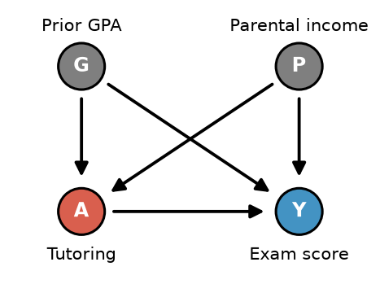

# Practice Quiz #3: Variation 1

**Name:** ______________________ **NetId:** ____________

[Worked solutions →](Variation1_Walkthrough.md)

---

## 1.

Suppose we have conditional exchangeability given some covariate $L$. In the table below, $A_i$ denotes the observed treatment, $Y_i$ denotes the observed outcome, $\hat E(Y\mid A=1,L=\ell_i)$ denotes the predicted outcome under treatment, $\hat E(Y\mid A=0,L=\ell_i)$ denotes the predicted outcome under no treatment, and $\hat\pi_i=\widehat{\Pr}(A=1\mid L=\ell_i)$ denotes the predicted propensity score.

| Individual | $A_i$ | $Y_i$ | $\hat E(Y\mid A=1,L=\ell_i)$ | $\hat E(Y\mid A=0,L=\ell_i)$ | $\hat\pi_i$ |
|:-:|:-:|:-:|:-:|:-:|:-:|
| 1 | 1 | 150 | 140 | 90 | .6 |
| 2 | 1 | 120 | 130 | 80 | .4 |
| 3 | 0 | 60 | 100 | 60 | .25 |
| 4 | 0 | 90 | 110 | 70 | .4 |

**(a)** Which choice below calculates an estimated **average treatment effect on the treated (ATT)** via the **g-formula** using the individuals in the table?

- ○ $\tfrac14(150+120+60+90)-\tfrac14(140+130+100+110)$
- ○ $\tfrac12(100+110)-\tfrac12(60+70)$
- ○ $\tfrac14(140+130+100+110)-\tfrac14(90+80+60+70)$
- ○ $\tfrac12(140+130)-\tfrac12(90+80)$
- ○ $\tfrac12(150+120)-\tfrac12(60+90)$

**(b)** Which choice below calculates an estimated **average treatment effect (ATE)** via the **g-formula** using the individuals in the table?

- ○ $\tfrac14(150+120+60+90)-\tfrac14(140+130+100+110)$
- ○ $\tfrac12(100+110)-\tfrac12(60+70)$
- ○ $\tfrac14(140+130+100+110)-\tfrac14(90+80+60+70)$
- ○ $\tfrac12(140+130)-\tfrac12(90+80)$
- ○ $\tfrac12(150+120)-\tfrac12(60+90)$

**(c)** Which choice below calculates an estimated **average treatment effect (ATE)** via **IPW** using the individuals in the table?

- ○ $\tfrac14\big[(150/(1-.6)+120/(1-.4))-(60/.25+90/.4)\big]$
- ○ $\tfrac12(150/.6+120/.4)-\tfrac12\big(60/(1-.25)+90/(1-.4)\big)$
- ○ $\tfrac14\big[(150/.6+120/.4)-(60/(1-.25)+90/(1-.4))\big]$
- ○ $\tfrac14\big[(150/.6+120/.4)-(60/.25+90/.4)\big]$

---

## 2.

Suppose you are trying to estimate the propensity score $P(A=1\mid L)$ for a set of covariates $L$. You have the option of fitting a logistic regression or using a random forest (a very flexible machine learning model). Suppose you only have 40 data points: which model would you prefer to use? Suppose you have 40,000 data points: which model would you prefer to use? Give a short explanation of why (1–2 sentences).

     

---

## 3.

Consider the causal graph below where we are interested in the causal effect of tutoring on exam scores. Note that $\{G,P\}$ is a sufficient adjustment set.

**(a)** Suppose we know that $P(A\mid G,P)$ follows a logistic regression, but $E(Y\mid A,G,P)$ is a very complex function. Which of the following methods would be a more reliable choice for estimating the ATE?

○ IPW  ○ Standardization / G-formula

**(b)** Suppose the same truth as in (a). We fit a logistic regression for $P(A\mid G,P)$ and a linear regression for $E(Y\mid A,G,P)$. Which of the following methods will give a reliable estimate of the ATE? (may choose more than one)

○ IPW  ○ Standardization / G-formula  ○ AIPW  ○ None of these

**(c)** Suppose the same truth as in (a). We fit a logistic regression for $P(A\mid G)$ and a linear regression for $E(Y\mid A,G)$ and don't include parental income ($P$) in either model. Which of the following methods will give a reliable estimate of the ATE?

○ IPW  ○ Standardization / G-formula  ○ AIPW  ○ None of these

---

## 4.

Suppose you are using a 1 to 1 matching procedure and are deciding between matching **with replacement** and matching **without replacement**.

**(a)** Which choice would have higher bias?

○ With replacement  ○ Without replacement

**(b)** Which choice would have higher variance?

○ With replacement  ○ Without replacement

---

## 5.

Suppose you are matching on the following covariates: annual income (measured in USD), age (measured in years), and years of work experience (measured in years). Explain why using the Mahalanobis distance is a better choice when compared to Euclidean distance. (Hint: think about *two* separate problems.)

     

---

## 6.

Suppose we have a more complex graph which requires matching on 25 covariates. Some covariates strongly predict treatment while others barely affect it. Explain why using propensity score matching might be preferred over coarsened exact matching, and name one thing you should check after performing the propensity score match.

     

---

## 7.

What is the name of at least 1 other person in your group (not including you)?
