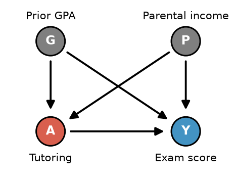

# Practice Quiz #3, Variation 1: Worked Solutions

[← Back to the quiz](Variation1_Quiz.md)

Try each question yourself first. Each solution covers what the question is really asking, how to work it out, the answer, and why the other options are wrong.

---

## Question 1: g-formula and IPW from a table

| Individual | $A_i$ | $Y_i$ | $\hat E(Y\mid A=1,L)$ | $\hat E(Y\mid A=0,L)$ | $\hat\pi_i$ |
|:-:|:-:|:-:|:-:|:-:|:-:|
| 1 | 1 | 150 | 140 | 90 | .6 |
| 2 | 1 | 120 | 130 | 80 | .4 |
| 3 | 0 | 60 | 100 | 60 | .25 |
| 4 | 0 | 90 | 110 | 70 | .4 |

### Step 0: decode the table before touching any option

- Rows 1–2 are **treated** ($A=1$) and rows 3–4 are **untreated** ($A=0$). So $N=4$ people in total, $n_t=2$ treated, and $n_c=2$ untreated.
- The two $\hat E$ columns are the outcome model's predictions of **each person's outcome if treated** and **if untreated**. The model predicts both, even for people who didn't actually get that treatment. That is the whole trick of the g-formula: fill in each person's missing potential outcome with a prediction.
- $\hat\pi_i$ is the probability that person $i$ gets treated, given their covariates. Only IPW uses this column, together with the observed $Y$.

> 💡 **Which columns go with which method?** The g-formula uses the two **prediction** columns. IPW uses $A$, $Y$, and $\hat\pi$. If an option for a g-formula question mixes in observed $Y$ values, be suspicious.

### (a) ATT via the g-formula

The ATT is the effect **among the treated**, so average only over the treated rows (1 and 2) and divide by $n_t=2$:

$$\widehat{ATT}=\frac1{n_t}\sum_{i:A_i=1}\Big[\hat E(Y\mid A=1,\ell_i)-\hat E(Y\mid A=0,\ell_i)\Big]=\tfrac12(140+130)-\tfrac12(90+80)=135-85=\mathbf{50}$$

✅ **Answer: option 4,** $\tfrac12(140+130)-\tfrac12(90+80)=50$.

**Why not the others?**
- **Option 1** compares observed $Y$ to predicted-if-treated. Both are "treated-world" quantities, so there is no treated vs untreated contrast at all.
- **Option 2** averages over the **untreated** rows (3, 4). That is the effect on the untreated (ATU).
- **Option 3** averages over **everyone**, which makes it the ATE (part b).
- **Option 5** is the naive difference in observed means: treated people's $Y$ minus untreated people's $Y$ ($135-75=60$). It ignores confounding, because the treated and untreated groups have different $L$. Adjusting for $L$ is exactly why we use the g-formula.

> 💡 You may also see the ATT computed with the treated people's **observed** $Y$ for the first term, since by consistency their $Y=Y^1$: $\tfrac12(150+120)-\tfrac12(90+80)=135-85=50$. That version isn't among the options here, but both are fine. The key is that only the treated rows are used and the untreated term comes from the $A=0$ prediction column.

### (b) ATE via the g-formula

The ATE averages over **everyone** ($N=4$): take the whole "if treated" column minus the whole "if untreated" column.

$$\widehat{ATE}=\frac1N\sum_{i=1}^N\hat E(Y\mid A=1,\ell_i)-\frac1N\sum_{i=1}^N\hat E(Y\mid A=0,\ell_i)$$
$$=\tfrac14(140+130+100+110)-\tfrac14(90+80+60+70)=\tfrac{480}{4}-\tfrac{300}{4}=120-75=\mathbf{45}$$

✅ **Answer: option 3** $=45$.

Notice the ATT (50) and ATE (45) differ: the treated people happen to benefit more than average. That is normal whenever the effect varies with $L$.

### (c) ATE via IPW

Recipe: each **treated** person contributes $Y/\hat\pi$, and each **untreated** person contributes $Y/(1-\hat\pi)$. Sum each group, subtract, and divide by the **total** $N$.

$$\widehat{ATE}_{IPW}=\frac1N\left[\sum_{i:A_i=1}\frac{Y_i}{\hat\pi_i}-\sum_{i:A_i=0}\frac{Y_i}{1-\hat\pi_i}\right]$$

| $i$ | $A$ | $Y$ | $\hat\pi$ | P(treatment they actually got) | weight | weighted $Y$ |
|:-:|:-:|:-:|:-:|:-:|:-:|:-:|
| 1 | 1 | 150 | .6 | .6 | $1/.6=1.67$ | $150/.6=$ **250** |
| 2 | 1 | 120 | .4 | .4 | $1/.4=2.5$ | $120/.4=$ **300** |
| 3 | 0 | 60 | .25 | $1-.25=.75$ | $1/.75=1.33$ | $60/.75=$ **80** |
| 4 | 0 | 90 | .4 | $1-.4=.6$ | $1/.6=1.67$ | $90/.6=$ **150** |

$$\widehat{ATE}_{IPW}=\tfrac14\big[(250+300)-(80+150)\big]=\tfrac14(550-230)=\tfrac{320}{4}=\mathbf{80}$$

✅ **Answer: option 3,** $\tfrac14\big[(150/.6+120/.4)-(60/(1-.25)+90/(1-.4))\big]=80$.

**Why not the others?**
- **Option 1** swaps the weights: it divides treated outcomes by $1-\hat\pi$ and untreated outcomes by $\hat\pi$. Always weight by the probability of the treatment the person **actually** received.
- **Option 2** has the right weights but divides by the group sizes ($\tfrac12$) instead of $N=4$. Each weighted sum rebuilds a pseudo-population the size of the **whole sample**, so you divide by $N$. (It would give $275-115=160$, double the right answer.)
- **Option 4** divides the untreated outcomes by $\hat\pi$ instead of $1-\hat\pi$.

> 💡 **Intuition check:** person 2 was treated even though $\hat\pi=.4$ (somewhat unlikely), so they stand in for $1/.4=2.5$ people like them. Person 1 had $\hat\pi=.6$ (likely to be treated), so they stand in for only 1.67 people. The rarer your treatment is for someone like you, the bigger your weight.

> ⚠️ **Why do the g-formula (45) and IPW (80) disagree?** They rely on *different* models: the outcome model vs the propensity model. With four people and imperfect models, there is no reason they should match; they agree only when both models are exactly right. (Bonus: AIPW, which combines both, gives $\hat E(Y^1)\approx117.9$ and $\hat E(Y^0)\approx83.3$, so $\widehat{ATE}_{AIPW}\approx34.6$.)

---

## Question 2: logistic regression vs random forest for the propensity score

This is a **bias–variance** question.
- A **simple model** (logistic regression) has few parameters. It is stable from sample to sample, but may be too rigid to capture the truth, which means **bias**.
- A **flexible model** (random forest) can capture almost any shape, so its bias is low. But with little data it chases noise, which means **high variance**.

✅ **40 data points: logistic regression.** With so few observations a random forest would overfit, so its propensity scores would swing wildly from sample to sample (high variance). Extreme $\hat\pi$ values would also make the IPW weights explode. Logistic regression may be a bit biased, but its variance is far lower.

✅ **40,000 data points: random forest.** With lots of data the forest's variance shrinks, and its flexibility captures nonlinear relationships and interactions between $L$ and treatment that logistic regression would miss (lower bias).

> 💡 Key phrase from lecture: *"Larger sample allows for more complex models."* The same logic applies whether you're modeling the outcome (the original Q2) or the treatment (this question).

---

## Question 3: choosing among IPW, g-formula, and AIPW

### Step 0: read the DAG

Prior GPA ($G$) and parental income ($P$) each cause both tutoring ($A$) and exam score ($Y$), so both are **confounders**. There are two backdoor paths:
- $A\leftarrow G\to Y$
- $A\leftarrow P\to Y$

Conditioning on $\{G,P\}$ blocks both, which is why it is a sufficient adjustment set.

Then run this **three-question checklist** for every part:
1. **Is the adjustment set used in the models sufficient?** If not, **nothing** is reliable.
2. **Is the outcome model correct?** If so, the g-formula ✅ and AIPW ✅.
3. **Is the propensity model correct?** If so, IPW ✅ and AIPW ✅.

### (a) The propensity is logistic, but the outcome is very complex

The treatment model is easy to get right, because a logistic regression is exactly what we'd fit. The outcome model is hard to get right. Use the method that relies on the model you can get right.

✅ **Answer: IPW.** *"If treatment is easier to predict than outcomes, use IPW."* The g-formula would depend on correctly modeling a very complex outcome function, which we probably would not manage.

### (b) Fit logistic for $P(A\mid G,P)$ and linear for $E(Y\mid A,G,P)$

| Model | True form | Fitted form | Correct? |
|---|---|---|---|
| Propensity $P(A\mid G,P)$ | logistic | logistic | ✅ |
| Outcome $E(Y\mid A,G,P)$ | very complex | linear | ❌ misspecified |

- IPW uses only the propensity model, which is correct ✅
- The g-formula uses only the outcome model, which is wrong ❌
- AIPW needs **either** model to be correct (double robustness) ✅

✅ **Answer: IPW and AIPW.**

### (c) Both models leave out parental income $P$

$P$ is a confounder. Leaving it out of **both** models leaves the backdoor path $A\leftarrow P\to Y$ **open**, so conditional exchangeability given $\{G\}$ alone fails. That is an **identification** problem, and no estimator can fix it:
- The g-formula's outcome model is missing a confounder ❌
- IPW's propensity model is missing a confounder ❌
- For AIPW, **both** models are wrong, and double robustness allows only a single failure ❌

✅ **Answer: none of these.**

> ⚠️ Common mistake: picking AIPW because it's "doubly robust." Double robustness protects against **one** misspecified model, not against a missing confounder that breaks both.

---

## Question 4: matching with vs without replacement

Think about what each rule forces you to do with your **controls**.

- **With replacement:** a control can be reused, so every treated unit gets its single **best** match even if that control is already taken. Matches are as close as possible, so bias is low. But a few controls may be reused many times, so the estimate leans heavily on a handful of people, which means **high variance**.
- **Without replacement:** once a control is used, it's gone. Later treated units can get stuck with worse matches, which means **higher bias**. But more distinct controls get used, so variance is lower.

**Tiny example:** two treated people aged 30 and 31, and two controls aged 30 and 50.
- With replacement, both treated people match the 30-year-old control. The matches are great, but both counterfactuals rest on one person.
- Without replacement, the 31-year-old is forced onto the 50-year-old. That is a bad match, and therefore bias.

✅ **(a) Higher bias: without replacement.**
✅ **(b) Higher variance: with replacement.**

> 💡 All the matching choices follow one pattern. Whatever gives each treated unit **closer matches** lowers bias, and whatever lets you **use more distinct data** lowers variance. That covers with vs without replacement, 1:1 vs k:1, and caliper vs no caliper.

---

## Question 5: Mahalanobis vs Euclidean distance

The hint points to the **two principles** behind Mahalanobis distance:

1. **Different scales (variances).** Euclidean distance, $\sqrt{\Delta\text{income}^2+\Delta\text{age}^2+\Delta\text{exp}^2}$, uses raw units. Income in dollars varies by tens of thousands, while age varies by tens of years. So income completely dominates the distance, and age and experience are effectively ignored.
2. **Correlated covariates.** Age and years of work experience move almost together, so Euclidean distance counts the same "older vs younger" information **twice**.

Mahalanobis distance,
$$d(i,j)=\sqrt{(\vec L_i-\vec L_j)^T\,\Sigma^{-1}\,(\vec L_i-\vec L_j)},$$
uses the variance–covariance matrix $\Sigma$. Dividing by each variance puts the covariates on a comparable scale, and the off-diagonal covariances correct for the overlap between age and experience.

**Numeric illustration.** Treated: age 40, experience 18, income \$60,000. U1: age 45, experience 23, income \$60,400. U2: age 40, experience 18, income \$63,000. Suppose the SDs are 10 years for age, 9 years for experience, and \$15,000 for income.

| | U1 | U2 | Picks |
|---|---|---|---|
| Euclidean | $\sqrt{5^2+5^2+400^2}\approx400$ | $\sqrt{3000^2}=3000$ | U1 |
| Standardized (Mahalanobis ignoring correlation) | $\sqrt{.5^2+.56^2+.03^2}\approx0.75$ | $\sqrt{.2^2}=0.20$ | U2 |

Euclidean picks U1 because a \$400 gap looks "smaller" than a \$3,000 gap, ignoring that U1 is 5 years older with 5 more years of experience. Once scale is accounted for, U2 is clearly the better match.

✅ **Model answer:** Euclidean distance depends on units, so income (in dollars) dominates and differences in age and experience barely count. It also double-counts age and experience, which are highly correlated. Mahalanobis distance rescales each covariate by its variance and accounts for their correlations through $\Sigma$. Every covariate then contributes on a comparable scale, and redundant information isn't counted twice.

---

## Question 6: propensity score matching vs coarsened exact matching

- **Curse of dimensionality.** CEM must match exactly on the coarsened version of **all 25** covariates. Even with only 2 bins each, that's $2^{25}\approx33$ million cells, so most treated units land in a cell with no controls and get dropped. The alternative is bins so coarse that the "matches" are poor.
- **One-number summary.** Propensity score matching collapses all 25 covariates into a single score, $\hat\pi=P(A=1\mid L)$, so close matches are easy to find. If the DAG is right, conditional exchangeability given $\pi(L)$ holds, and matched groups are balanced on $L$ **on average**.
- **Varying importance.** The propensity score automatically emphasizes covariates that strongly predict treatment and down-weights the ones that barely matter. CEM treats every covariate as equally important.

**What to check afterwards: covariate balance.** Before looking at outcomes, compare the means and distributions (e.g. histograms) of each covariate, and of $\hat\pi$, between the treated units and their matched controls. Also check the **overlap** of the propensity score distributions, since a lack of overlap may signal a positivity violation.

✅ **Model answer:** With 25 covariates, CEM suffers from the curse of dimensionality: there are so many cells that most treated units won't find a match and get dropped. Propensity score matching reduces all 25 covariates to one number, so matches are easy to find, and it prioritizes the covariates that matter most for treatment. Afterwards, check covariate balance (and propensity score overlap) between treated units and matched controls, because PSM only guarantees balance on average.

---

## Question 7

Name someone in your project group (not graded content).
