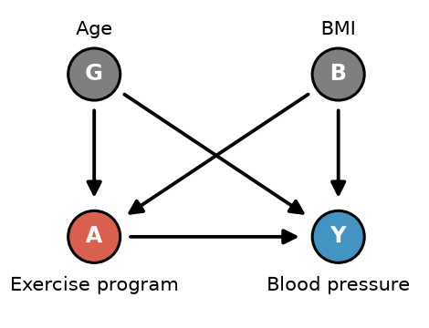

# Practice Quiz #3: Variation 2

**Name:** ______________________ **NetId:** ____________

[Answer key →](Variations2-4_AnswerKey.md#variation-2)

---

## 1.

Suppose we have conditional exchangeability given some covariate $L$. In the table below, $A_i$ denotes the observed treatment, $Y_i$ denotes the observed outcome, $\hat E(Y\mid A=1,L=\ell_i)$ denotes the predicted outcome under treatment, $\hat E(Y\mid A=0,L=\ell_i)$ denotes the predicted outcome under no treatment, and $\hat\pi_i=\widehat{\Pr}(A=1\mid L=\ell_i)$ denotes the predicted propensity score.

| Individual | $A_i$ | $Y_i$ | $\hat E(Y\mid A=1,L=\ell_i)$ | $\hat E(Y\mid A=0,L=\ell_i)$ | $\hat\pi_i$ |
|:-:|:-:|:-:|:-:|:-:|:-:|
| 1 | 1 | 95 | 90 | 50 | .5 |
| 2 | 1 | 110 | 100 | 60 | .8 |
| 3 | 1 | 80 | 80 | 40 | .4 |
| 4 | 0 | 40 | 60 | 40 | .2 |
| 5 | 0 | 45 | 70 | 50 | .25 |

**(a)** Which choice below calculates an estimated **average treatment effect on the treated (ATT)** via the **g-formula** using the individuals in the table?

- ○ $\tfrac13(95+110+80)-\tfrac12(40+45)$
- ○ $\tfrac12(60+70)-\tfrac12(40+50)$
- ○ $\tfrac15(90+100+80+60+70)-\tfrac15(50+60+40+40+50)$
- ○ $\tfrac15(95+110+80+40+45)-\tfrac15(90+100+80+60+70)$
- ○ $\tfrac13(90+100+80)-\tfrac13(50+60+40)$

**(b)** Which choice below calculates an estimated **average treatment effect (ATE)** via the **g-formula** using the individuals in the table?

- ○ $\tfrac13(95+110+80)-\tfrac12(40+45)$
- ○ $\tfrac12(60+70)-\tfrac12(40+50)$
- ○ $\tfrac15(90+100+80+60+70)-\tfrac15(50+60+40+40+50)$
- ○ $\tfrac15(95+110+80+40+45)-\tfrac15(90+100+80+60+70)$
- ○ $\tfrac13(90+100+80)-\tfrac13(50+60+40)$

**(c)** Which choice below calculates an estimated **average treatment effect (ATE)** via **IPW** using the individuals in the table?

- ○ $\tfrac15\big[(95/.5+110/.8+80/.4)-(40/.2+45/.25)\big]$
- ○ $\tfrac15\big[(95/.5+110/.8+80/.4)-(40/(1-.2)+45/(1-.25))\big]$
- ○ $\tfrac13(95/.5+110/.8+80/.4)-\tfrac12\big(40/(1-.2)+45/(1-.25)\big)$
- ○ $\tfrac15\big[(95/(1-.5)+110/(1-.8)+80/(1-.4))-(40/(1-.2)+45/(1-.25))\big]$

---

## 2.

Suppose you are trying to build a model to predict $Y$ given $A$ (the treatment) and 8 binary covariates $L$. Option 1 is a linear regression with one coefficient per variable. Option 2 is the "observed average" approach: compute the mean of $Y$ separately within every combination of $A$ and the 8 covariates ($2\times2^8=512$ cells). Suppose you only have 200 data points: which option would you prefer? Suppose you have 200,000 data points: which option would you prefer? Give a short explanation of why (1–2 sentences).

     

---

## 3.

Consider the causal graph below where we are interested in the causal effect of an exercise program on blood pressure. Note that $\{G,B\}$ is a sufficient adjustment set.

**(a)** Suppose we know that $E(Y\mid A,G,B)$ is linear, but $P(A\mid G,B)$ is a very complex function. Which of the following methods would be a more reliable choice for estimating the ATE?

○ IPW  ○ Standardization / G-formula

**(b)** Suppose the same truth as in (a), and our sample is very large. We fit a flexible machine learning model that correctly captures $P(A\mid G,B)$, and a linear regression for $E(Y\mid A,G)$ that leaves out BMI ($B$). Which of the following methods will give a reliable estimate of the ATE? (may choose more than one)

○ IPW  ○ Standardization / G-formula  ○ AIPW  ○ None of these

**(c)** Suppose the same truth as in (a). We fit a linear regression for $E(Y\mid A,G,B)$ and a logistic regression for $P(A\mid G)$ that leaves out BMI ($B$). Which of the following methods will give a reliable estimate of the ATE? (may choose more than one)

○ IPW  ○ Standardization / G-formula  ○ AIPW  ○ None of these

---

## 4.

Suppose you are using a 1 to 1 nearest-neighbor matching procedure on age and are deciding between using **no caliper** and using a **caliper of 2 years**.

**(a)** Which choice would have higher bias?

○ No caliper  ○ Caliper of 2 years

**(b)** Which choice would have higher variance?

○ No caliper  ○ Caliper of 2 years

---

## 5.

Suppose you are matching a treated individual (age 40, 12 years of education) to one of two controls: U1 (age 43, 16 years of education) or U2 (age 48, 12 years of education). Across the population, age has standard deviation 10 years and education has standard deviation 2 years (assume they are uncorrelated). Which control is the nearest match under Manhattan distance, Euclidean distance, and Mahalanobis distance? Briefly explain why Mahalanobis gives a different answer and why it is the better choice.

     

---

## 6.

Suppose we want to match on a single continuous covariate, annual income (in USD). Explain why exact matching on income would likely fail, how coarsened exact matching fixes the problem, and what bias–variance trade-off you face when choosing the width of the income bins.

     

---

## 7.

What is the name of at least 1 other person in your group (not including you)?
