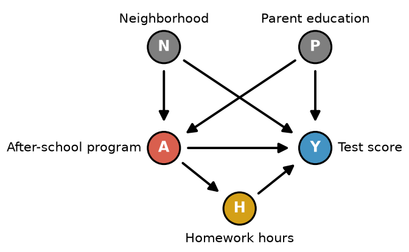

# Practice Quiz #3: Variation 3

**Name:** ______________________ **NetId:** ____________

[Answer key →](Variations2-4_AnswerKey.md#variation-3)

---

## 1.

Suppose we have conditional exchangeability given some covariate $L$. In the table below, $A_i$ denotes the observed treatment, $Y_i$ denotes the observed outcome, $\hat E(Y\mid A=1,L=\ell_i)$ denotes the predicted outcome under treatment, $\hat E(Y\mid A=0,L=\ell_i)$ denotes the predicted outcome under no treatment, and $\hat\pi_i=\widehat{\Pr}(A=1\mid L=\ell_i)$ denotes the predicted propensity score.

| Individual | $A_i$ | $Y_i$ | $\hat E(Y\mid A=1,L=\ell_i)$ | $\hat E(Y\mid A=0,L=\ell_i)$ | $\hat\pi_i$ |
|:-:|:-:|:-:|:-:|:-:|:-:|
| 1 | 0 | 40 | 70 | 45 | .2 |
| 2 | 1 | 120 | 110 | 60 | .6 |
| 3 | 0 | 63 | 80 | 55 | .3 |
| 4 | 1 | 90 | 100 | 70 | .75 |

**(a)** Which choice below calculates an estimated **average treatment effect on the treated (ATT)** via the **g-formula** using the individuals in the table?

- ○ $\tfrac12(70+80)-\tfrac12(45+55)$
- ○ $\tfrac12(110+100)-\tfrac12(60+70)$
- ○ $\tfrac14(40+120+63+90)-\tfrac14(70+110+80+100)$
- ○ $\tfrac14(70+110+80+100)-\tfrac14(45+60+55+70)$
- ○ $\tfrac12(120+90)-\tfrac12(40+63)$

**(b)** Which choice below calculates an estimated **average treatment effect (ATE)** via the **g-formula** using the individuals in the table?

- ○ $\tfrac12(70+80)-\tfrac12(45+55)$
- ○ $\tfrac12(110+100)-\tfrac12(60+70)$
- ○ $\tfrac14(40+120+63+90)-\tfrac14(70+110+80+100)$
- ○ $\tfrac14(70+110+80+100)-\tfrac14(45+60+55+70)$
- ○ $\tfrac12(120+90)-\tfrac12(40+63)$

**(c)** Which choice below calculates an estimated **average treatment effect (ATE)** via **IPW** using the individuals in the table?

- ○ $\tfrac14\big[(120/(1-.6)+90/(1-.75))-(40/.2+63/.3)\big]$
- ○ $\tfrac14\big[(120/.6+90/.75)-(40/.2+63/.3)\big]$
- ○ $\tfrac14\big[(120/.6+90/.75)-(40/(1-.2)-63/(1-.3))\big]$
- ○ $\tfrac14\big[(120/.6+90/.75)-(40/(1-.2)+63/(1-.3))\big]$

---

## 2.

Suppose you are fitting a propensity model $P(A=1\mid L)$ where $L$ contains 12 covariates. Option 1 is a logistic regression with only the 12 main effects. Option 2 is a logistic regression with all main effects, all pairwise interactions, and all squared terms (about 90 parameters). Suppose you only have 60 data points: which option would you prefer? Suppose you have 60,000 data points: which option would you prefer? Give a short explanation of why (1–2 sentences).

     

---

## 3.

Consider the causal graph below where we are interested in the **total** causal effect of an after-school program on test scores. Note that $\{N,P\}$ is a sufficient adjustment set.

**(a)** Suppose $E(Y\mid A,N,P)$ is linear and we model it correctly. However, several individuals have estimated propensity scores very close to 0 or 1 (e.g. 0.01 and 0.99). Which of the following methods would be a more reliable (more stable) choice for estimating the ATE?

○ IPW  ○ Standardization / G-formula

**(b)** Suppose both $E(Y\mid A,N,P)$ and $P(A\mid N,P)$ are simple, and we correctly specify both models, but we **also** include homework hours ($H$) as a covariate in both models. Which of the following methods will give a reliable estimate of the total ATE?

○ IPW  ○ Standardization / G-formula  ○ AIPW  ○ None of these

**(c)** Suppose $P(A\mid N,P)$ is a very complex function and we fit it with a linear regression, while we fit $E(Y\mid A,N,P)$ with a flexible model that (thanks to a very large sample) captures it correctly. Which of the following methods will give a reliable estimate of the ATE? (may choose more than one)

○ IPW  ○ Standardization / G-formula  ○ AIPW  ○ None of these

---

## 4.

Suppose you are using a matching procedure and are deciding between 1 to 1 matching and 3 to 1 matching.

**(a)** Which choice would have higher variance?

○ 1 to 1  ○ 3 to 1

**(b)** Which choice would have higher bias?

○ 1 to 1  ○ 3 to 1

---

## 5.

Suppose you are matching on the following covariates: SAT score (ranging from 400 to 1600) and high-school GPA (ranging from 0.0 to 4.0). Explain why using the Mahalanobis distance is a better choice when compared to Euclidean distance.

     

---

## 6.

You perform propensity score matching. Before looking at any outcomes, you compare covariates and find that the treated group has a mean age of 52 while the matched control group has a mean age of 38. What does this suggest went wrong, and name two things you could do about it.

     

---

## 7.

What is the name of at least 1 other person in your group (not including you)?
