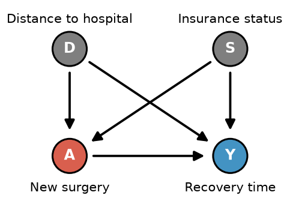

# Practice Quiz #3: Variation 4

**Name:** ______________________ **NetId:** ____________

[Answer key →](Variations2-4_AnswerKey.md#variation-4)

---

## 1.

Suppose we have conditional exchangeability given some covariate $L$. In the table below, $A_i$ denotes the observed treatment, $Y_i$ denotes the observed outcome, $\hat E(Y\mid A=1,L=\ell_i)$ denotes the predicted outcome under treatment, $\hat E(Y\mid A=0,L=\ell_i)$ denotes the predicted outcome under no treatment, and $\hat\pi_i=\widehat{\Pr}(A=1\mid L=\ell_i)$ denotes the predicted propensity score.

| Individual | $A_i$ | $Y_i$ | $\hat E(Y\mid A=1,L=\ell_i)$ | $\hat E(Y\mid A=0,L=\ell_i)$ | $\hat\pi_i$ |
|:-:|:-:|:-:|:-:|:-:|:-:|
| 1 | 1 | 88 | 80 | 50 | .8 |
| 2 | 1 | 60 | 70 | 40 | .5 |
| 3 | 0 | 45 | 75 | 50 | .4 |
| 4 | 1 | 63 | 60 | 30 | .7 |

**(a)** Which choice below calculates an estimated **average treatment effect on the treated (ATT)** via the **g-formula** using the individuals in the table?

- ○ $\tfrac14(80+70+75+60)-\tfrac14(50+40+50+30)$
- ○ $75-50$
- ○ $\tfrac13(80+70+60)-\tfrac13(50+40+30)$
- ○ $\tfrac13(88+60+63)-45$
- ○ $\tfrac14(88+60+45+63)-\tfrac14(80+70+75+60)$

**(b)** Which choice below calculates an estimated **average treatment effect (ATE)** via the **g-formula** using the individuals in the table?

- ○ $\tfrac14(80+70+75+60)-\tfrac14(50+40+50+30)$
- ○ $75-50$
- ○ $\tfrac13(80+70+60)-\tfrac13(50+40+30)$
- ○ $\tfrac13(88+60+63)-45$
- ○ $\tfrac14(88+60+45+63)-\tfrac14(80+70+75+60)$

**(c)** Which choice below calculates an estimated **average treatment effect (ATE)** via **IPW** using the individuals in the table?

- ○ $\tfrac14\big[(88/.8+60/.5+63/.7)-45/.4\big]$
- ○ $\tfrac13(88/.8+60/.5+63/.7)-45/(1-.4)$
- ○ $\tfrac14\big[(88/.8+60/.5+63/.7)-45/(1-.4)\big]$
- ○ $\tfrac14\big[(88/(1-.8)+60/(1-.5)+63/(1-.7))-45/.4\big]$

---

## 2.

Suppose the true relationship between an outcome $Y$ and a single covariate $L$ is curved (e.g. $Y=e^L$). You can fit either a linear regression or a degree-10 polynomial regression. Suppose you only have 20 data points: which model would you prefer? Suppose you have 1,000 data points: which model would you prefer? Also, which model's error would **not** go away even with 1,000,000 data points? Give a short explanation (1–2 sentences).

     

---

## 3.

Consider the causal graph below where we are interested in the causal effect of a new surgery on recovery time. Note that $\{D,S\}$ is a sufficient adjustment set.

**(a)** Suppose the hospital assigned the surgery using a published logistic regression rule based on $D$ and $S$, but recovery time depends on $D$, $S$, and $A$ in a very complex way. Which of the following methods would be a more reliable choice for estimating the ATE?

○ IPW  ○ Standardization / G-formula

**(b)** Suppose the same truth as in (a), and our sample is very large. We fit flexible machine learning models that correctly capture both $P(A\mid D,S)$ and $E(Y\mid A,D,S)$. Which of the following methods will give a reliable estimate of the ATE? (may choose more than one)

○ IPW  ○ Standardization / G-formula  ○ AIPW  ○ None of these

**(c)** Suppose the same truth as in (a). We fit a linear regression (a linear probability model) for $P(A\mid D,S)$ and a linear regression for $E(Y\mid A,D,S)$. Which of the following methods will give a reliable estimate of the ATE?

○ IPW  ○ Standardization / G-formula  ○ AIPW  ○ None of these

---

## 4.

Suppose you are using 1 to 1 propensity score matching and are deciding between a **narrow caliper** ($|\hat\pi_i-\hat\pi_j|\le0.01$) and a **wide caliper** ($|\hat\pi_i-\hat\pi_j|\le0.25$).

**(a)** Which choice would have higher bias?

○ Narrow caliper  ○ Wide caliper

**(b)** Which choice would have higher variance?

○ Narrow caliper  ○ Wide caliper

---

## 5.

Suppose you are matching on annual income and age using Euclidean distance. A classmate re-runs your analysis with income recorded in *thousands* of USD instead of USD and gets different matches. Explain why this happens and why Mahalanobis distance would not have this problem.

     

---

## 6.

A classmate says: "We used propensity score matching on 30 covariates and achieved excellent balance on all of them, so our estimate of the ATT is causal." Suppose the true DAG contains an unmeasured variable $U$ that affects both treatment and the outcome. Explain what is wrong with the classmate's claim.

     

---

## 7.

What is the name of at least 1 other person in your group (not including you)?
